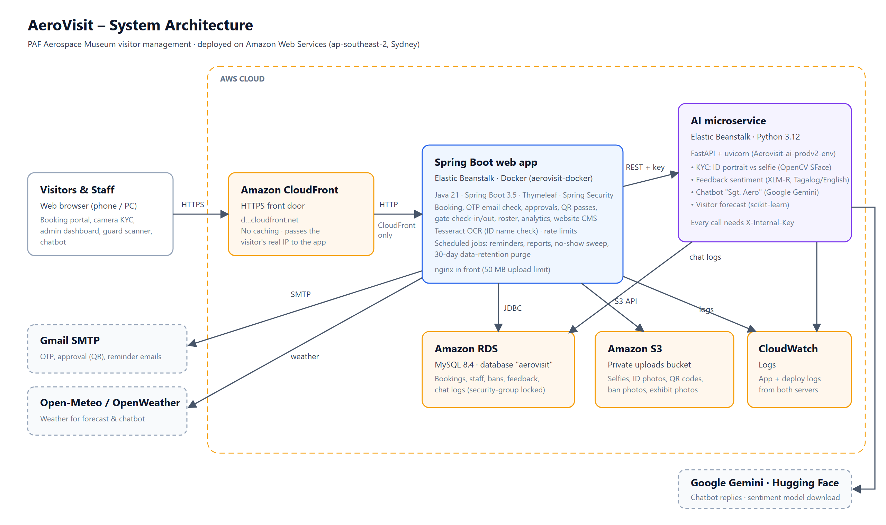
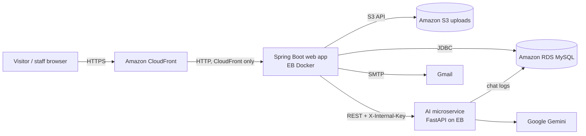

# AeroVisit

Visitor management system for the **Philippine Air Force Aerospace Museum**: online booking with email verification and
two-step identity check (KYC), director approval with QR entry passes, guard gate check-in/out, staff rostering,
analytics, an AI chatbot ("Sgt. Aero") and feedback sentiment analysis.



## Architecture

| Part | Technology | Where it runs |
|---|---|---|
| **Web app** (`aerovisit/`) | Java 21, Spring Boot 3.5, Thymeleaf, Spring Security, Spring Data JPA, Tesseract OCR (tess4j) | AWS Elastic Beanstalk, Docker platform (`aerovisit-docker`) |
| **AI microservice** (`AeroVisit-AI/`) | Python 3.12, FastAPI + uvicorn, OpenCV (YuNet + SFace), transformers (XLM-R), scikit-learn, Google Gemini | AWS Elastic Beanstalk, Python platform (`Aerovisit-ai-prodv2-env`) |
| **Database** | MySQL 8.4 | Amazon RDS (`aerovisit-db`, database `aerovisit`) |
| **File storage** | Selfies, ID photos, QR codes, ban photos, exhibit photos | Amazon S3 private bucket (copy of `uploads/`, see `UploadMirror`) |
| **HTTPS front door** | Amazon CloudFront (no caching) | The only public address; the web app's security group accepts traffic from CloudFront only |
| **Email** | Gmail SMTP (`PAFMuseumOfficial@gmail.com`) | OTP codes, approval with QR code, reminders, check-in/out, reports |
| **Logs** | Amazon CloudWatch Logs | App and deployment logs from both servers |

How a request flows:



Key design rules:

- **Human in the loop.** Nothing is approved automatically. The KYC check only labels a booking
  (**Identity Verified (face + name)** or **Identity Unverified**); staff decide. Only a face on the biometric ban list
  is refused automatically.
- **The AI service is private.** Every request needs the shared `X-Internal-Key`; only the web app calls it.
- **Privacy (R.A. 10173).** A nightly job anonymises finished visits after 30 days and deletes their photos and face
  vectors, locally and in S3.

## Repository layout

```
AeroVisit_Project/
├── aerovisit/                     Spring Boot web app
│   ├── src/main/java/com/paf/aerovisit/
│   │   ├── controller/            Web pages and endpoints (visitor portal, admin, guard, staff, CMS)
│   │   ├── service/               Business logic (email, KYC, OCR, S3 mirror, automation jobs, …)
│   │   ├── repository/            Database access (Spring Data JPA)
│   │   ├── model/                 Database entities
│   │   ├── security/              Rate limiting, client IP, login rules
│   │   ├── config/                Spring Security and web configuration
│   │   ├── scheduler/             Nightly jobs (roster archive, AI accuracy audit)
│   │   └── chatbot/               Chatbot bridge to the AI service
│   ├── src/main/resources/        application.properties, templates (pages + email/), static files
│   ├── src/test/java/             JUnit / MockMvc tests
│   ├── Dockerfile                 Image for Elastic Beanstalk (Java 21 + Tesseract)
│   └── .platform/nginx/conf.d/    nginx upload limit for Elastic Beanstalk
├── AeroVisit-AI/                  Python AI microservice
│   ├── main.py                    FastAPI app: chatbot, sentiment, forecast, retraining
│   ├── kyc.py                     KYC: ID card crop, face match, blur gate
│   ├── models/                    Face detection and recognition models (ONNX)
│   ├── Procfile                   Start command for Elastic Beanstalk
│   └── .platform/nginx/conf.d/    nginx upload limit for Elastic Beanstalk
└── docs/                          Architecture diagram (SVG + PNG)
```

## Running locally

### Prerequisites
- Java 21, MySQL 8 (local database `aerovisit_db_v2`)
- Python 3.12 (the AI service)
- Tesseract OCR for Windows (default path `C:/Program Files/Tesseract-OCR/tessdata`), for the ID name check

### Web app
1. Copy `aerovisit/.env.example` to `aerovisit/.env` and fill in the values you need (at least `DB_PASSWORD` for your
   local MySQL, `AEROVISIT_MAIL_PASSWORD` to send emails, and `AI_INTERNAL_KEY`). `.env` is git-ignored.
2. From `aerovisit/`:
   ```
   ./mvnw spring-boot:run
   ```
3. Open http://localhost:8081

Without `DB_URL` the app uses the local database `aerovisit_db_v2`; without `AEROVISIT_S3_BUCKET` uploads stay in the
local `uploads/` folder.

### AI microservice
1. Create `AeroVisit-AI/.env` with `GEMINI_API_KEY`, `AI_INTERNAL_KEY` (same value as the web app) and, for chat
   history, `DB_HOST`, `DB_USERNAME`, `DB_PASSWORD`, `DB_NAME`.
2. From `AeroVisit-AI/`:
   ```
   pip install -r requirements.txt
   uvicorn main:app --host 127.0.0.1 --port 8000
   ```
   The first start downloads the sentiment model from Hugging Face.

## Tests

**Web app** (908 tests): run against your **local** database, never the live one:
```
cd aerovisit
./mvnw test
```
Expected: `Tests run: 908, Failures: 0, Errors: 0, Skipped: 0` and `BUILD SUCCESS`. Reports are in
`aerovisit/target/surefire-reports/`. The gate tests use a fixed clock, so results do not depend on the time of day.

**AI microservice** (70 tests):
```
cd AeroVisit-AI
python -m unittest test_kyc test_chat_sessions test_persona_scope test_rate_limits
```
Run with `AI_INTERNAL_KEY` empty (e.g. PowerShell `$env:AI_INTERNAL_KEY=""`), otherwise the endpoint tests are refused
with 401 by the internal-key check.

## Configuration

Values come from environment variables (Elastic Beanstalk → Configuration → Environment properties) or a local `.env`.
Never put real values in `application.properties`. Names must not contain spaces (Docker refuses to start).

### Web app (`aerovisit-docker`)

| Variable | Purpose |
|---|---|
| `DB_URL`, `DB_USERNAME`, `DB_PASSWORD` | Database connection (default: local `aerovisit_db_v2`, user `root`) |
| `AEROVISIT_S3_BUCKET` | S3 bucket for uploads (blank = local folder only) |
| `AI_SERVICE_URL`, `AI_INTERNAL_KEY` | Address of the AI service and the shared key |
| `AEROVISIT_MAIL_PASSWORD` | Gmail App Password (no emails without it) |
| `PUBLIC_BASE_URL` | Public HTTPS address used in email links (the CloudFront address) |
| `SERVER_TOMCAT_REMOTEIP_PROTOCOLHEADER` | `CloudFront-Forwarded-Proto`, so the app knows visitors use HTTPS |
| `AEROVISIT_DIRECTOR_PASSWORD`, `AEROVISIT_GUARD_PASSWORD` | Initial staff passwords |
| `ALERT_EMAIL`, `OPENWEATHER_API_KEY` | Critical-feedback alert inbox; weather for the forecast |
| `TESSDATA_PATH`, `TZ`, `SERVER_PORT` | Set by the `Dockerfile` (Linux Tesseract data, `Asia/Manila`, `5000`) |

### AI microservice (`Aerovisit-ai-prodv2-env`)

| Variable | Purpose |
|---|---|
| `GEMINI_API_KEY`, `AI_INTERNAL_KEY` | Chatbot model access; shared key with the web app |
| `DB_HOST`, `DB_PORT`, `DB_USERNAME`, `DB_PASSWORD`, `DB_NAME` | Database for chat history and forecast data |
| `KYC_MIN_FACE_SHARPNESS`, `KYC_MIN_ID_FACE_SHARPNESS` | Blur thresholds for the selfie and the printed ID portrait |
| `PYTHONUNBUFFERED` | `1`, so log lines reach CloudWatch immediately |

## Deployment (AWS Elastic Beanstalk)

### Web app → `aerovisit-docker`
1. Run the tests, then build the jar: `./mvnw package -DskipTests` (from `aerovisit/`).
2. Make a zip with these three entries at its top level:
   ```
   Dockerfile
   aerovisit.jar                              (target/aerovisit-0.0.1-SNAPSHOT.jar, renamed)
   .platform/nginx/conf.d/upload_size.conf
   ```
3. Elastic Beanstalk → `aerovisit-docker` → **Upload and deploy** the zip.

Always include `.platform`: without it nginx falls back to a 1 MB upload limit and photo uploads fail with 413.
Add any new environment property **before** deploying a version that needs it.

### AI microservice → `Aerovisit-ai-prodv2-env`
Zip with `Procfile`, `requirements.txt`, `main.py`, `kyc.py`, `models/` and `.platform/` at the top level (no `.env`,
`venv/`, tests or `__pycache__`), then **Upload and deploy**. The first start downloads the sentiment model (about a
minute).

### Infrastructure notes
- **CloudFront:** origin = the web app's Elastic Beanstalk address, HTTP only, port 80; cache policy `CachingDisabled`;
  origin request policy `AllViewerAndCloudFrontHeaders-2022-06`.
- **Security groups:** the web app accepts HTTP only from the CloudFront prefix list; RDS (`aerovisit-rds-sg`) accepts
  MySQL only from the two Elastic Beanstalk security groups (plus your own IP for database tools).
- **IAM:** the instance role `aws-elasticbeanstalk-ec2-role` has an inline policy `AeroVisitUploadsS3` allowing
  Put/Get/Delete on the uploads bucket only.

## Scheduled jobs (Manila time)

| Time | Job |
|---|---|
| 07:00 | Reminder emails (with QR code) for tomorrow's visits |
| 17:30 | Base sweep: automatic check-out of visitors whose time window has ended, with the feedback email |
| 23:59 | No-show sweep; AI forecast accuracy audit |
| 00:00 | Director's daily report; archive of past duty shifts |
| 02:00 | Data-retention purge (anonymise after 30 days, delete photos and face vectors) |

## Further documentation

- [`FUNCTIONAL_SPECIFICATION.md`](FUNCTIONAL_SPECIFICATION.md): every feature and the booking status lifecycle
- [`TECHNICAL_SPECIFICATION.md`](TECHNICAL_SPECIFICATION.md): database schema, API endpoints, QR logic, roles
- [`AirForce-Deployment-Guide.md`](AirForce-Deployment-Guide.md): switching to an official mail server
- [`ONBOARDING.md`](ONBOARDING.md): team setup
