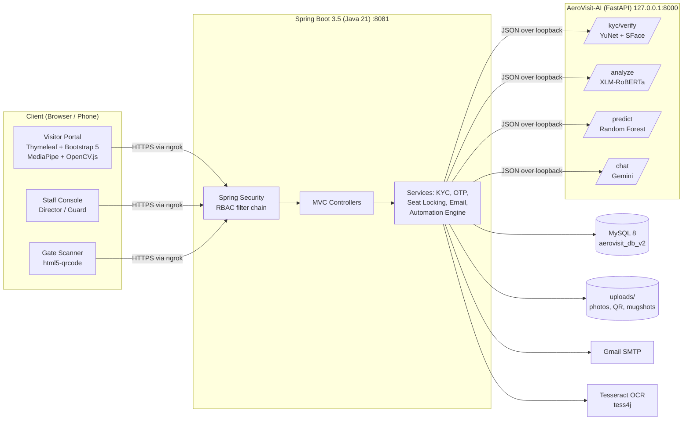
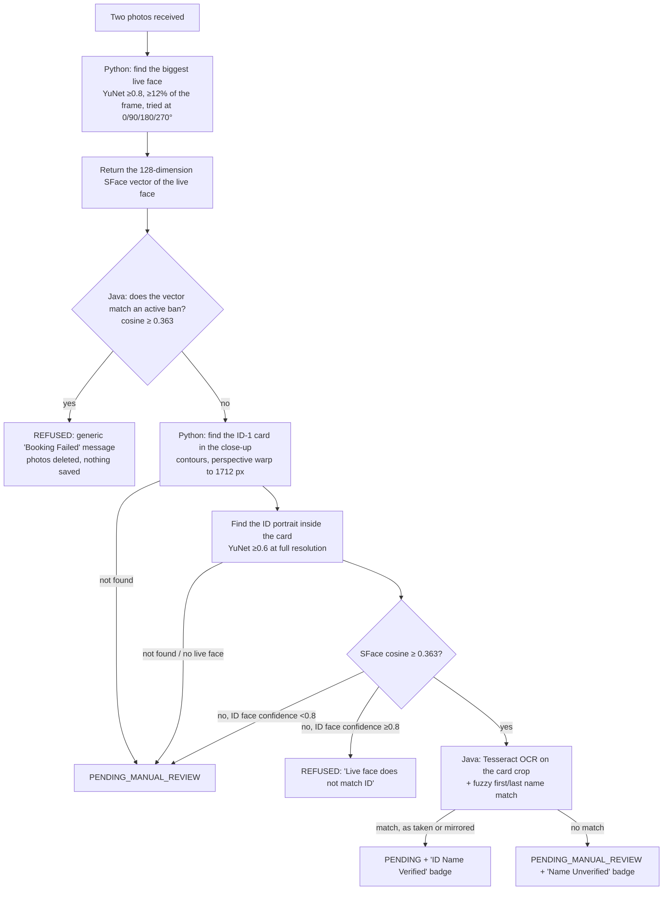
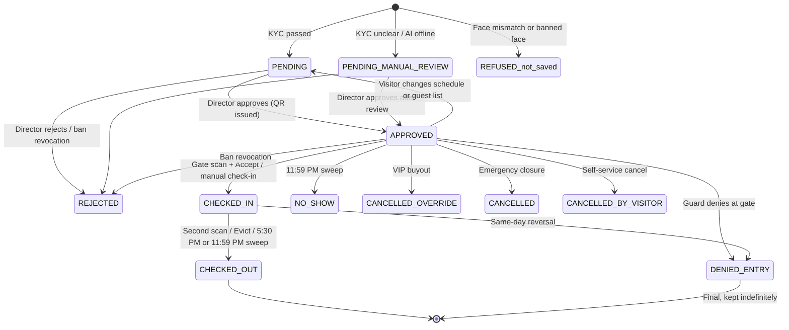

# AeroVisit: System Architecture and Functional Audit Report

**System:** AeroVisit, the Visitor Management and Base Access Control System of the Philippine Air Force Aerospace Museum (Villamor Air Base, Pasay City)
**Audit type:** Source-level architecture, functional and security audit (static review of the code; no live penetration test)
**Audit date:** 9 October 2026
**Codebase state:** after the 2026-10-09 changes (Guard RBAC, Gate Dashboard, Security Gallery, Silent Security, Selfie Pro Tip)

---

## Executive Summary

AeroVisit is a three-tier web system made of three parts:

1. **A server-rendered Spring Boot 3.5 / Java 21 application.** It holds the visitor portal, the Director's command dashboard and the Guard's gate dashboard.
2. **A MySQL database.**
3. **A separate local Python (FastAPI) AI microservice.** It does the computer-vision identity checks (OpenCV YuNet + SFace), the sentiment analysis (XLM-RoBERTa), the attendance forecasting (Random Forest) and the visitor chatbot (Gemini).

Identity assurance is layered:

1. **Possession** of an email inbox, proven with a 6-digit one-time password.
2. **Document presence**, through a two-step capture of the government ID.
3. **Liveness**, through a randomised challenge-response with a mandatory blink.
4. **1:1 biometric matching** of the ID portrait against the live face.
5. **1:N screening** of the live face against a biometric ban list.
6. **OCR name verification** of the ID, with fuzzy matching.
7. **A mandatory human decision.** No booking is ever approved automatically (Human-in-the-Loop).

Access control is enforced on the server by Spring Security with two roles, `DIRECTOR` and `GUARD`, under a least-privilege model. The Guard sees only today's gate operations, and booking review is reserved for the Director. Data-privacy controls follow the Philippine Data Privacy Act of 2012 (R.A. 10173):

- explicit consent at booking;
- a published Privacy Policy that discloses the biometric processing;
- anonymous file names;
- staff-only access to uploaded files;
- automatic deletion of photos, QR codes and face templates 30 days after the visit.

The test suite has **671 automated Java tests** (last full run 2026-10-09: 671 passed, 0 failed) and **46 Python unit tests**. Section 6 lists the residual risks and known limitations found during this audit, and which of them have since been fixed. They are presented openly so they can be discussed as limitations and future work.

---

## Audit Methodology

The following were read and cross-checked against each other:

| Layer | Artifacts reviewed |
|---|---|
| Security configuration | `config/SecurityConfig.java`, `application.properties`, `WebConfig`, `MvcConfig`, `GlobalModelAdvice`, `CmsUploadLimitAdvice` |
| Controllers (13) | `VisitorPortalController`, `OtpController`, `GuardOperationController`, `GuardDashboardController`, `AdminDashboardController`, `ManagementController`, `IdVerificationController`, `ContentManagementController`, `NotificationApiController`, `TimeWindowController`, `MuseumZoneController`, `AiAdvisorController` |
| Services | `KycService`, `FaceEncodings`, `FuzzyNameMatcher`, `OcrService`, `OtpService`, `SeatReservationService`, `EmailService`, `AeroVisitAutomationEngine`, `NotificationService`, `PredictiveAdvisorService`, `WeatherService`, `ChatRateLimiter` |
| Domain model | `Visitor`, `BlacklistedFace`, `BookingSlot`, `TimeWindowConfig`, `MuseumClosure`, `StaffSchedule`, `MuseumEmployee`, `AdminNotification`, CMS entities |
| Templates | `register.html` (booking + liveness engine), `admin.html`, `guard.html`, `blacklist.html`, `scanner.html`, `fragments/ban.html`, `fragments/shell.html`, `fragments/visitor.html`, `error.html` |
| AI microservice | `AeroVisit-AI/main.py`, `AeroVisit-AI/kyc.py`, ONNX models in `AeroVisit-AI/models/` |
| Tests | `src/test/**` (61 test classes), `test_kyc.py`, `test_chat_sessions.py`, `test_persona_scope.py` |

---

## 1. The Technology Stack

### 1.1 System Topology

**Deployment notes:**

- **Public HTTPS through ngrok.** TLS ends at ngrok. Spring is set to `server.forward-headers-strategy=native` (Tomcat `RemoteIpValve`), so it trusts `X-Forwarded-Proto/For` only from local or private proxies. This keeps redirects on `https://` and stops visitors from spoofing their IP address.
- **The AI service is local only.** It binds to `127.0.0.1:8000` (`uvicorn.run(app, host="127.0.0.1", port=8000)`), so the Internet cannot reach it directly.
- **The JVM clock is pinned to `Asia/Manila`** (`AerovisitApplication.pinTimeZone`). Every scheduled job and gate time window therefore runs on Philippine time, whatever the host's time zone.

### 1.2 Frontend Technologies

| Concern | Technology | Where / how it is used |
|---|---|---|
| Templating | **Thymeleaf** (Spring Boot starter) | All pages are rendered on the server. Shared layout fragments: `fragments/shell.html` (staff head, sidebar, header, scripts) and `fragments/visitor.html` (public navbar, footer, legal modals, welcome modal). |
| CSS framework | **Bootstrap 5.3.0** (CDN), **Bootstrap Icons 1.11.1** | Grid, modals (`#kycModal`, `#banModal`, `#denyModal`), tabs, dropdowns. |
| Design system | Custom token-based CSS: `static/styles/theme.css` (273 lines), `admin.css` (1,279), `visitor.css` (1,153) | Colour tokens on `:root` with the PAF palette (#002B80 navy, #D2AF39 gold, #EC2B2A red). The staff console has a "brutalist / operational" look; the visitor portal is a high-end public-facing design. |
| Typography | Google Fonts: **Jost** + **JetBrains Mono** (staff); **Bricolage Grotesque** + **Plus Jakarta Sans** (public) | Defined as `--font-ops`, `--font-mono`, `--font-display`, `--font-public`. |
| Theming | `static/js/theme.js` | Persistent light/dark switch. Follows `prefers-color-scheme` until the user chooses. |
| Responsive design | 30 `@media` blocks across the three stylesheets | Breakpoints 576/768/992/1200 px; `(pointer: coarse)` blocks for 44 px touch targets; orientation-aware scanner sizing. The gate table becomes stacked cards under 768 px (`.av-gate-table`), and the gallery uses CSS Grid `auto-fill`. `prefers-reduced-motion` is respected. |
| Calendars | **FullCalendar 6.1.10** | Public booking calendar (seat availability colour legend), slot planner and duty roster. |
| Charts | **Chart.js 4.5.1** (pinned with a SHA-256 Subresource Integrity hash) | Director analytics: traffic, peak hours, funnel, feedback insights. |
| Data tables | DataTables 1.13.6 + jQuery 3.6.0 | Staff tables. |
| QR scanning | **html5-qrcode 2.3.8** (pinned with SRI) | Camera-based gate scanner at 20 fps with an adaptive `qrbox`. |
| Face liveness | **Google MediaPipe Tasks-Vision 1.1.0** `FaceLandmarker` (478-point face mesh, WASM, GPU with CPU fallback) | Challenge-response liveness in `register.html`. Loaded only when the visitor presses *Start camera*. |
| ID-card detection | **OpenCV.js 4.12** (`@techstark/opencv-js`) | Detects the ID-1 card in the browser during both capture steps. |
| Browser APIs | `getUserMedia`, Canvas `toBlob`, `DataTransfer`, Web Crypto `getRandomValues`, Web Speech API | Camera capture, writing captured frames into ordinary file inputs, unbiased random challenge selection, chatbot voice input. |
| Custom JS | `static/js/visitor.js` (pre-loader, welcome modal), `shell.js` (sidebar, notification bell polling), page scripts | Plain JavaScript (no build step or bundler). |

### 1.3 Backend Technologies

| Concern | Technology | Detail |
|---|---|---|
| Runtime | **Java 21**, **Spring Boot 3.5.16** | Maven build (`mvnw`); `spring-boot-devtools` in development. |
| Web layer | Spring MVC (`spring-boot-starter-web`), embedded Tomcat on port **8081** | `@Controller`s with the Post/Redirect/Get pattern and flash attributes; `@RestController` JSON endpoints for OTP, scanner, notifications, zones and the chatbot. |
| Persistence | **Spring Data JPA / Hibernate**, **MySQL 8** (`mysql-connector-j`), schema `aerovisit_db_v2` | `ddl-auto=update`; derived queries plus JPQL (`sumSeatsHeld`, `findBuyoutDates`, `findClosureDates`, `findExpiredWithFiles`). |
| Concurrency control | `@Lock(PESSIMISTIC_WRITE)` on `BookingSlotRepository.lockBySlotDateAndTimeWindow` inside a `@Transactional` service | `SeatReservationService.saveIfSeatsRemain` closes the "last seat" race condition. |
| Security | **Spring Security 6** | Form login with two staff accounts, `director` and `guard` (in-memory `UserDetailsService`, **BCrypt** password hashes), URL authorisation rules, **CSRF protection** (synchronizer token in forms, `X-CSRF-TOKEN` header for `fetch`), POST-only logout that invalidates the session, a custom `AuthenticationEntryPoint` (404 for non-staff URLs), session cookie `HttpOnly` + `SameSite=Strict`. |
| Email | `spring-boot-starter-mail` (JavaMail) over Gmail SMTP with STARTTLS | 10-second connect/read/write timeouts. HTML emails with a QR attachment. |
| QR codes | **ZXing 3.5.1** (`core`, `javase`) | `QRCodeGenerator`: 250×250 PNG that encodes only an unguessable UUID token. |
| OCR | **Tess4J 5.11.0** (Tesseract) + jai-imageio + TwelveMonkeys ImageIO (JPEG/WebP) | `OcrService` re-renders the image onto a clean RGB canvas before OCR. |
| Reporting | **OpenPDF 1.3.30** (PDF log), **Apache POI 5.5.1** (`.xlsx` export) | Director-only exports. |
| Scheduling | `@EnableScheduling` + cron jobs | 7:00 AM reminders, 5:30 PM base sweep, 11:59 PM no-show sweep, 11:59 PM AI forecast accuracy audit, 12:00 AM Director report and roster archiving, 2:00 AM data-retention purge. |
| Configuration | `.env` loaded through `spring.config.import=optional:file:.env[.properties]` | Database, mail, staff passwords and API keys come from environment variables with fallbacks. |
| JSON | `org.json` | Talks to the AI microservice. |

### 1.4 AI Microservice (`AeroVisit-AI`)

| Endpoint | Technology | Purpose |
|---|---|---|
| `POST /kyc/verify` | OpenCV (`opencv-python-headless` < 5), **YuNet** face detector + **SFace** face recognizer (ONNX, from opencv_zoo) | Cuts the ID card out of the photo, compares the ID portrait with the live face 1:1, and returns the live face's 128-dimension embedding. |
| `GET /analyze` | Hugging Face Transformers, `cardiffnlp/twitter-xlm-roberta-base-sentiment` (multilingual; reads Tagalog/Taglish), loaded with `local_files_only=True` | Sentiment and a critical-alert flag on visitor feedback, plus a local keyword topic classifier (Root Cause Matrix). |
| `GET /predict`, `POST /retrain` | scikit-learn `RandomForestRegressor` | Attendance forecast from day of week, weather and pre-booked count. |
| `POST /chat` | Google Gemini (`google-genai`) | "Sgt. Aero" visitor assistant, with per-session chat history (LRU cache) and a strict scope/persona prompt. This is the only feature that uses an outside AI API. |

Identity biometrics and sentiment analysis run **100% locally**. No photo or face template is sent to an outside service.

### 1.5 Testing Framework

| Layer | Tooling | Scope |
|---|---|---|
| Java unit + slice tests | **JUnit 5**, **Spring Boot Test**, **MockMvc**, `@WebMvcTest` slices with `@MockitoBean` repositories, **spring-security-test** (`user().roles()`, `csrf()`) | 70 test classes, **671 tests** in the last full run (2026-10-09), all passing. Every state-changing request in the tests carries a CSRF token, as a real browser must. |
| Persistence tests | **H2** in-memory database (test scope only) | Proves the pessimistic seat lock (`SeatReservationLockTest`, with a negative control that fails without `@Lock`) and the export queries. |
| Full-context test | `AerovisitApplicationTests` (`@SpringBootTest`) | Starts the whole application against MySQL. |
| Python tests | `unittest` with fakes for OpenCV, MySQL and Gemini | `test_kyc.py` (27), `test_chat_sessions.py` (9), `test_persona_scope.py` (10). |
| Browser verification | Headless Chrome through the DevTools Protocol, with fake camera input (`--use-file-for-fake-video-capture`) | Used during development to check the liveness engine, the ID gate and responsive layouts. |

Security-relevant test classes include `SecurityRulesTest`, `GuardDashboardTest`, `BiometricBanTest`, `BanIntegrityTest`, `KycServiceTest`, `EmailOtpSelfieBookingTest`, `OtpServiceTest`, `ApprovalStateMachineTest`, `ApprovalCapacityRaceTest`, `PostOnlyActionsTest`, `DataRetentionPurgeTest`, `AnonymousIdPhotoNameTest`, `PinnedCdnScriptsTest` and `PortalContentTest`.

---

## 2. Visitor Portal (Front-End Flow)

### 2.1 The Complete Booking Process

The public booking form (`register.html`, `GET /`) is a three-step wizard with a progress stepper:

| Step | Title | What the visitor does |
|---|---|---|
| **01** | **Arrival Date** | Picks a date and time window on a FullCalendar view built from `BookingSlot` records. Availability is colour-coded: **green** = open, **orange** = 15 seats or fewer left, **red/greyed** = full, reserved by a VIP buyout or closed for an emergency. Seat counts include only seat-holding bookings (`APPROVED`, `CHECKED-IN`, `CHECKED-OUT`); `PENDING` requests are a waitlist and hold no seat. A "Large Educational Tour?" panel lets schools with 50+ guests switch on **Master Booking** mode. |
| **02** | **Visitor Profile** | Name, sex, age, address, affiliation, contact number, group size and purpose. Groups must list every companion by name (the **Group Manifest**). In Master mode, companions can be typed row by row, pasted in bulk or uploaded as a CSV/TXT file. **Email verification:** *Send Code* → 6-digit OTP → *Verify*. |
| **03** | **Clearance & Consent** | The two-step KYC camera capture (Section 2.2), the Selfie Pro Tip, the museum guidelines, and one required consent box that covers the guidelines, the Terms of Entry and the Privacy Policy under R.A. 10173. |

**Email OTP (`OtpService`, `OtpController`)** replaced Google reCAPTCHA. It works as both a bot barrier and a proof that the visitor owns the email address:

| Control | Value |
|---|---|
| Code | 6 digits from `SecureRandom`, valid for **5 minutes** |
| Resend cooldown | 60 seconds |
| Wrong attempts | 5, then the code is burned |
| Rate limits | 5 sends per email per hour; 10 sends per client IP per hour (behind ngrok the IP is the proxy-added, last `X-Forwarded-For` hop) |
| Comparison | Constant-time (`MessageDigest.isEqual`), so response timing reveals nothing about the code |
| Verified window | 30 minutes to finish the form; **one verified code = one booking** (`consume()` after a successful save) |

**Server-side validation pipeline (`POST /save`, in execution order).** The server never trusts the browser:

1. **Mass-assignment guard.** An `@InitBinder` whitelist binds only the 15 public form fields. `status`, `secureToken`, `referenceId` and the check-in fields cannot be injected.
2. **Emergency-closure check.** Nobody, Master Bookings included, can book a closed date.
3. **OTP gate.** The email must be verified. The check fails closed if the OTP service is missing.
4. **Duplicate check.** One active booking per email per date.
5. **VIP-buyout check.** A date reserved by an approved Master Booking is closed to regular bookings.
6. **Ghost-slot check.** The date and time window must match a real `BookingSlot`; there is no default capacity.
7. **Capacity check** for standard bookings.
8. **Master Booking rules.** An official justification is required, and only this flow may use the Master purpose label.
9. **Group Manifest.** The number of companions must equal *group size − 1*. Names may contain only letters, digits, spaces and `. , ' ( ) / -`, up to 100 characters each.
10. **File checks.** Only JPEG or PNG; 15 MB upload limit. Files are saved under **anonymous UUID names**.
11. **Two-step KYC screening** (Section 2.2).
12. **Reference ID.** A server-generated **Booking Reference ID** (`PAF-` plus 6 characters from `SecureRandom` over an alphabet without look-alike characters), checked for uniqueness.
13. **Race-safe save.** `SeatReservationService.saveIfSeatsRemain` takes a pessimistic row lock on the slot and re-counts seats inside the transaction.
14. **Notifications.** The OTP is consumed, a "pending review" email is sent, and the Director's bell gets an alert for groups larger than 15.

**After booking:**

- `/check-status` needs **both** the email and the Reference ID, because an email alone is guessable.
- **Manage Booking** (`/manage-booking`) is a self-service portal. Sign-in rotates the session ID (`changeSessionId()`, against session fixation), and every form must echo back a per-session form token, which acts as a CSRF token for this portal.
- Visitors can change the date, window, group size, contact number and guest list, or cancel. Changing an **APPROVED** booking sends it back to `PENDING` and cancels the old QR code.

### 2.2 The Two-Step KYC (Government ID + Selfie)

Two photos are captured and uploaded as ordinary multipart files:

| Step | Form field | Content | Camera |
|---|---|---|---|
| 1 | `highResIdImage` | A close-up of the ID alone, flattened (for OCR and the ID portrait) | Phone **back camera** preferred (`facingMode: {ideal: 'environment'}`); the prompt says *"Place your ID flat on a table…"*. On webcams the prompt says *"Hold your ID up to the camera…"*. |
| 2 | `livenessImage` | A liveness selfie with the visitor **holding the same ID** | Front camera, after the challenge-response is passed |

**Server-side decision logic.** `KycService.screen()` in Java and `kyc.verify_two_step()` in Python work together:

**Design properties:**

- **Blacklist check first (anti-Sybil).** The live face vector is taken and screened *before* any ID-side check. A banned person cannot avoid the screening by covering the ID portrait, changing the name or using a new email address.
- **Refusal only on high confidence.** A booking is refused automatically in only two cases: (a) an active ban matches, or (b) *both* faces were found with full confidence and clearly belong to different people. Every unclear case (glare, hologram, no card found, weak portrait detection, AI service offline, missing models, Tesseract not installed) **degrades gracefully** to `PENDING_MANUAL_REVIEW`. The visitor is never shown a technical error.
- **Fuzzy OCR name matching** (`FuzzyNameMatcher`):
  - bounded two-row Levenshtein distance, with tolerance by word length: 1–3 letters exact, 4–7 letters one edit, 8+ letters two edits;
  - the first and last names must match **different** OCR words;
  - multi-word surnames are compared without spaces ("DELA CRUZ" = "DELACRUZ" = "DE LA CRUZ");
  - accents are removed ("PEÑA" = "PENA");
  - OCR look-alike digits are kept inside words ("N1CHOLAS").
- **Mirror recovery.** Front cameras often save mirrored photos, which makes the ID text unreadable. A failed OCR pass is retried once on a horizontally flipped crop (reason `OK_MIRRORED`).
- **Zero trust for Master Bookings.** The lead booker of a group booking goes through exactly the same pipeline. A request that reaches `/save` with no photos at all can only come from bypassing the form; it goes to `PENDING_MANUAL_REVIEW` and never looks like a passed check.
- **Fail-safe service boundary.** The Python endpoint never returns HTTP 500. Java treats a timeout (20 s), a non-200 answer or an unreadable answer as "manual review".

### 2.3 Liveness Detection: Mechanism, Quirks and UI Instructions

Liveness runs **in the visitor's browser** (MediaPipe FaceLandmarker plus OpenCV.js). No video is uploaded; only the two final still frames leave the device.

**Challenge-response engine (`createChallengeEngine`):**

- **Randomised challenges.** Two different moves are drawn with `crypto.getRandomValues` from four options: *Blink*, *Open Your Mouth*, *Turn Your Head Left*, *Turn Your Head Right* (12 possible ordered pairs). A pre-recorded video cannot know which pair will be asked.
- **Metrics from the 478-point face mesh:**
  - **Eye Aspect Ratio (EAR)** = (|p2−p6| + |p3−p5|) / 2|p1−p4|, using the 6 standard eye landmarks;
  - **Mouth Aspect Ratio (MAR)** = inner-lip gap / mouth width;
  - **Head yaw** = position of the nose tip between the two cheek edges;
  - a **face aspect ratio** guard.
- **Adaptive thresholds.** The engine learns the visitor's own open-eye and closed-mouth baseline (an exponential moving average) before it asks for anything. A blink is detected below `min(0.20, 0.75 × baseline EAR)`. This copes with people who naturally have narrow eyes.
- **Mandatory blink.** Development testing showed that a printed photo swung or tipped in front of the camera can fake head turns and even mouth opening in the face mesh, but **cannot fake a blink**. A blink must be seen at some point: a natural blink counts, and if none was seen the engine adds *"Last step: Please Blink"*.
- **Anti-replay rules:**
  - doing the *wrong* deliberate move, or running out of the **12-second** time limit, restarts the round with a **new** random pair;
  - after **3 rounds** the camera stops.
- **Tilt / photo guard.** A face whose height-to-width ratio drifts by more than 10% from the baseline is rejected. Tilting a printed photo backwards squashes the face shape and the EAR together, unlike a real blink.
- **Largest-face rule.** The ID portrait the visitor holds can itself be detected as a face, so the engine always tracks the **largest** face.
- **ID-card presence gate (OpenCV.js).**
  - The challenge clock runs only while **both** the face (red oval when missing, `.is-no-face`) **and** the ID card (inside its guide box) are visible. The engine's `hold()`/`resume()` freeze the timer otherwise.
  - Step 1 captures automatically once the card fills at least 35% of the large ID-1 frame and stays steady for 1 second (checked 4 times per second).
  - Step 2 needs the card at 10% or more of its smaller guide box, because a front-camera ID held at arm's length looks small.

**UI and UX features:**

| Feature | Purpose |
|---|---|
| **Full-screen camera modal** (`#livenessModal`, z-index 9999, moved to `<body>` by the script) | Gives the visitor the whole screen. The scroll lock (`html.vp-cam-open`) stops the page from moving underneath. |
| **SVG alignment guide** (face oval + ID-card rectangle, viewBox equal to the camera frame, `preserveAspectRatio="xMidYMid meet"`) | Lines up exactly with the video's `object-fit: contain` on any screen shape. |
| **Live prompts** (`aria-live="polite"`) | "Step 1 of 2…", "Challenge 1/2: Please Turn Your Head Left", "✓ Challenges passed. Look straight at the camera and hold still…". Accessible to screen readers. |
| **Mirroring logic** | Front camera shown as a mirror; back camera shown as is (`.is-rear`). The card-detection region is mirrored to match. |
| **Selfie Pro Tip** (💡) | *"For the fastest verification, hold your device slightly above eye level in a well-lit area."* Shown with both the camera and the fallback inputs, but never inside the full-screen modal, so it never covers the guides. |
| **Inline tips** | "Hold your ID **beside** your face, not covering it, with the printed side facing the camera." / "Every booking is reviewed by museum personnel before your entry pass is sent." |
| **Graceful fallback** | If the camera is unavailable or denied, the page is on plain HTTP, the browser is too old, or the models take more than 20 s to load, the two plain file inputs appear instead (`capture="environment"` for the ID, `capture="user"` for the selfie). The server-side KYC still runs, so security does not depend on the browser. |
| **Retake** | The visitor can redo the capture before submitting. Thumbnails of both captured photos are shown. |

**Known quirks (stated openly):**

1. The browser liveness check is a **presentation-attack deterrent, not a certified PAD (ISO/IEC 30107-3) system**. In internal simulations, a replayed video passed a single camera session in roughly 23–35% of attempts. Because the check runs on the client, a skilled attacker could post photos straight to `/save`. This is why the server-side 1:1 face match, the ban screening and the **mandatory human approval** remain the authoritative controls.
2. The ID-card detector looks for an ID-1-shaped bright rectangle (aspect ratio 1.25–2.0). A plain sheet of paper of that shape can satisfy it. Very dark rooms and a white card on a white background can fail it.
3. On low-end phones without GPU acceleration, MediaPipe's first frame can take several seconds. The 20-second load timeout then falls back to file upload.

### 2.4 QR Code Ticket Generation and Email Notifications

**QR ticket.** When the Director approves a booking (`GuardOperationController.approveVisitor`):

1. The seat count is re-checked under a pessimistic lock.
2. ZXing renders a 250×250 PNG (`uploads/QR_<id>.png`) that encodes **only** the booking's `secureToken`, a random UUID (122 bits of entropy). No name, ID number or other personal data is in the QR code, and the token cannot be forged with a free QR generator. (The old `ID:x | Name:y` format was removed.)
3. The approval email is sent with the QR attached (`Entry_QRCode.png`) and the Booking Reference ID.

**QR lifecycle.**

| Event | What happens to the QR |
|---|---|
| Rejection, cancellation, gate denial, no-show, buyout override, ban revocation | `qrCodeUrl` is cleared. The token also stops working at the gate, because the gate admits only `APPROVED` bookings. |
| Date or guest-list change on an approved booking | The booking returns to `PENDING`; the old QR stops working until the booking is approved again. |
| 30-day retention purge | The QR file is deleted. |

**Email notifications (`EmailService`, Gmail SMTP, HTML):**

| Trigger | Email |
|---|---|
| OTP request | 6-digit verification code (5-minute validity) |
| Booking submitted | "Pending review" with the Reference ID (Master Booking variant) |
| Approval / Force Approve | Approval + QR attachment + Reference ID |
| 7:00 AM daily job | Reminder with the QR for tomorrow's approved visitors (sent once: `reminderSent` flag) |
| Gate check-in | Check-in guidelines naming the Tour Guide on duty (from the duty roster) |
| Check-out (scan, manual, or the 5:30 PM / 11:59 PM sweeps) | Feedback request with a token link to the After-Action Report form |
| Rejection | Reason-specific notice ("Capacity Reached" switches to a rebooking email) |
| VIP buyout approved | Cancellation notice to each displaced visitor |
| Emergency closure | Emergency cancellation notice |
| Duty roster published | Schedule email to staff |
| Critical negative feedback (AI: negative and score > 0.75) | Alert to the system alert inbox |
| Midnight | Director's daily security report (expected / checked in / no-shows) |

Emails sent from the gate scanner go out on a background thread (`CompletableFuture`), so the guard gets the result immediately. All SMTP calls have 10-second timeouts, so a slow mail server cannot freeze a booking or approval.

### 2.5 The "Silent Security" Protocol

When the live face of a person trying to book matches an **active** biometric ban:

1. `KycService` returns `REFUSED` with the constant `FACE_BANNED`. The message is **deliberately generic**:
   > *"Booking Failed. We are unable to process your request at this time. Please try again later or contact the reception desk for assistance."*
2. **Nothing is saved.** Both uploaded photos are deleted from disk (`discardIdPhoto`), and no database row is created, so the attempt cannot be seen as a booking.
3. The message does not say *banned*, *blacklisted*, *restricted* or *recognised*. The subject therefore cannot tell that the face was identified, and does not learn that changing name or email will not help. This denies them feedback for probing the system (a security-through-non-disclosure measure that **adds to** the real control, not one that replaces it).
4. Visitor-facing status pages (`/check-status`, Manage Booking) show only friendly labels such as "Not Approved" through `visitorStatusLabel()`. The internal `rejectionReason` ("Access revoked: visitor banned (…)") is **write-only**: staff can see it, the visitor never does.
5. When a ban is issued, the person's **existing** open bookings (pending, or approved for today or later) under *any* email are revoked on the server (`revokeOpenBookings`) and their QR codes are cancelled. If the person shows up at the gate, the scan only says *"ACCESS DENIED: Visitor rejected."*

**Defence in depth after booking.** The same ban check runs again at **approval** (`BANNED_APPROVAL`), **Force Approve**, **QR scan / Accept** and **manual check-in** (`BANNED_ENTRY`). All of them go through one function, `FaceEncodings.isBanned`, which also ignores expired temporary bans consistently.

**Scope limit.** Only the **lead booker's** face is captured. Companions in a group or Master Booking are listed by name only. The design relies on *Representative Liability* (the lead booker answers for the group) and on the *Physical Chokepoint* (guards compare each guest's ID with the manifest and the Banned Visitors gallery at the gate).

---

## 3. Admin / Director Dashboard (Back-Office Flow)

### 3.1 The PENDING Queue and the Manual Review Process

The Director's command dashboard (`/admin`, `admin.html`) has three tabs: **Today's Manifest**, **Pending Approval** (`?filter=pending`) and **Entire Database** (`?filter=all`).

- **Queue contents.** The Pending tab lists every booking in `Visitor.APPROVABLE_STATUSES`: `PENDING`, `PENDING_MANUAL_REVIEW` and the legacy `VERIFIED`.
- **Ordering.** **FIFO** by `createdAt` (oldest first) by default, with a newest-first option, plus a visit-date filter.
- **Triage cues on every row:**
  - a **NEW** badge for bookings less than 24 hours old;
  - an **"ID Name Verified"** (green) or **"Name Unverified"** (amber) OCR badge;
  - **Master Booking** justification text;
  - group size and companion list;
  - a **View KYC** button.
- **KYC viewer** (`#kycModal`). One shared modal shows the **ID close-up and the liveness selfie side by side** on desktop and stacked on phones (CSS grid `auto-fit minmax(min(100%, 320px), 1fr)`). The photos are cleared from the DOM when the modal closes.
- **Daily Capacity Tracker** and **Live Base Occupancy** panels give the Director seat context before approving.
- **Notification bell.** It polls `/api/notifications` every 30 seconds and shows unread alerts plus the pending count (Director only).

**Review actions and their server-side guards:**

| Action | Endpoint | Guards |
|---|---|---|
| Approve | `POST /admin/approve/{id}` | **State machine:** only `APPROVABLE_STATUSES` can move to `APPROVED`; `DENIED_ENTRY` is final. **Ban re-check.** **Ghost-slot check.** **Just-in-time capacity** under a pessimistic lock. Master Booking approval triggers the **VIP buyout**: approved public visitors on that date become `CANCELLED_OVERRIDE` and are emailed. |
| Force Approve | `POST /admin/approve-override/{id}` | Director only. Skips the seat count **only**: the ban, a valid slot and pending status are still required; not allowed for Master Bookings. Logged on the server console as a capacity override. |
| Reject with reason | `POST /admin/reject-visitor` | A preset reason plus optional notes, stored in `rejectionReason`, and a reason-specific email. Refused for `DENIED_ENTRY` and for visits that are underway or over. |
| Delete | `POST /admin/delete/{id}` | Director only. Deletes the photos and QR files with the row. |

### 3.2 Human-in-the-Loop (HITL) Handling of Edge Cases

**Principle:** `KycService` *never* returns `APPROVED`. The constant and the code path were removed. Automation only **sorts** bookings (normal queue vs manual review) and **refuses** the two high-confidence threats. Every admission decision is made by a person.

| Edge case | What the system does | Where the human decides |
|---|---|---|
| **Minors / visitors without a government ID** | The code has **no special branch for age**. A minor's booking (age field ≥ 1) goes through the same pipeline. If the "ID" is missing, has no portrait or cannot be read, the result is `NO_ID_CARD`, `NO_ID_FACE` or `NAME_MISMATCH`, which means `PENDING_MANUAL_REVIEW` and a "Name Unverified" badge. The booking is **not** refused. | The Director reads the photos in the KYC viewer and approves or rejects using museum policy (for example, admission with a guardian or as a companion on a parent's or school's booking). The rule lives in policy, not in code; see Section 6. |
| **School IDs, company IDs, other ID-1 cards** | The card detector accepts any ISO/IEC 7810 **ID-1-shaped** card (85.60 × 53.98 mm; aspect ratio window 1.25–2.0). PhilSys, driver's licences, UMID, school and company IDs are all found the same way. A school ID with a small, glossy or hologram-covered portrait is searched at full crop resolution with a lower detection threshold (YuNet 0.6). A *mismatch* against a weakly detected portrait is routed to review (`UNSURE_ID_FACE`) instead of being refused. | The Director checks that the ID type is acceptable and that the person in the selfie is the cardholder. |
| **Portrait vs landscape IDs and photos** | (1) `warp_card()` turns a card held **upright (portrait)** into landscape so OCR reads the text horizontally. (2) Face detection on both the selfie and the ID portrait tries **0°, 90°, 180° and 270°** (`_biggest_face_any_turn`), which handles sideways phone photos and vertical-format IDs. (3) A **mirrored** card is OCR'd a second time after flipping. | Any orientation that still fails becomes manual review, never a refusal. |
| **Glare, holograms, blur, low light** | Graceful degradation: the result `face_match_error = "Face detection unclear - routing to manual review."` and the live face vector is **kept**, so the ban screening still applies. | The Director sees the original photos. |
| **AI service offline / models missing / Tesseract missing** | `AI_SERVICE_UNAVAILABLE`, `FACE_MODELS_UNAVAILABLE`, `OPENCV_UNAVAILABLE` or `ERROR`, which all lead to `PENDING_MANUAL_REVIEW`. The booking flow never breaks. | Full manual verification. |

### 3.3 Proactive Biometric Banning

From the manifest's row menu, the Director can ban a visitor **before** the person ever arrives, for example after spotting a fake ID in the KYC viewer.

- **Shared dialog** (`fragments/ban.html`, `#banModal`):
  - **Reason:** Fake ID Uploaded / Repeated No-Shows / Misconduct on Premises / Security Threat / Other.
  - **Duration:** **30 days** (default) / **6 months** / **Permanent**.
  - The form has no `action` until a row is chosen, so it cannot be submitted against the wrong visitor.
- **Endpoint:** `POST /admin/biometric-ban/{visitorId}`. It:
  1. copies the booking's SFace vector into `blacklisted_faces`;
  2. records the visitor's name, and a **separate copy** of the liveness selfie (`uploads/ban-<uuid>.jpg`), because the booking's own photo is purged after 30 days;
  3. **revokes every open booking with the same face under any email**.
- **Re-banning** a face that is already banned keeps the **longer** ban (permanent wins) and the newest reason.
- A booking **without face data** (none detected, older than face matching, or already purged) shows a disabled *"(no face data)"* ban item and the server explains why.
- **Enforcement uses the vector only.** The name and mugshot are for display and never decide anything.

### 3.4 Director Full Access vs Guard Restrictions

**Permission matrix** (enforced in `SecurityConfig` and in handler-level checks):

| Capability | Endpoint(s) | Director | Guard |
|---|---|:---:|:---:|
| Full manifest, pending queue, entire database, KYC viewer | `GET /admin` | ✅ | ↪ redirected to `/guard/dashboard` |
| Approve / reject / review bookings | `/admin/approve/**`, `/admin/reject/**`, `/admin/reject-visitor`, `/api/booking/**` | ✅ | ⛔ 403 |
| Pending-count API, pending part of the bell | `/admin/api/pending-count` | ✅ | ⛔ 403 (bell shows 0) |
| Force Approve over capacity | `/admin/approve-override/**` | ✅ | ⛔ 403 |
| Delete visitor records | `/admin/delete/**` | ✅ | ⛔ 403 |
| Lift a ban | `/admin/bans/{id}/lift` | ✅ | ⛔ 403 |
| Staff, roster, slots, time windows, emergency closure | `/admin/staff/**`, `/admin/slots/**`, `/admin/employee/**` | ✅ | ⛔ 403 |
| Website content (CMS) | `/admin/content/**` | ✅ | ⛔ 403 |
| PDF log / Excel export / mock data | `/admin/report`, `/admin/export-excel`, `/admin/inject-mock-data` | ✅ | ⛔ 403 |
| Strategic analytics | `/admin/analytics` | ✅ | ↪ redirected (checked in the handler) |
| Museum zones (write) | `/api/zones/**` | ✅ | ⛔ 403 |
| Gate Dashboard | `/guard/dashboard` | ✅ | ✅ |
| QR scanner, verify-then-confirm check-in, deny entry | `/admin/scanner`, `/admin/api/scan`, `/admin/api/confirm-check-in`, `/admin/api/deny-entry`, `/admin/deny-entry` | ✅ | ✅ |
| Manual check-in of an **approved** pass / check-out | `/admin/manual-checkin` | ✅ | ✅ |
| Manual check-in of a **non-approved** booking (override) | `/admin/manual-checkin` | ✅ | ⛔ refused in the handler (`SecurityConfig.isDirector()`) |
| Ban a visitor | `/admin/biometric-ban/{id}` | ✅ | ✅ |
| View the Banned Visitors gallery, mugshots, scanner selfie | `/admin/blacklist`, `/uploads/**` | ✅ | ✅ |
| Duty roster calendar (read), settings | `/admin/calendar`, `/admin/settings` | ✅ | ✅ |

The sidebar (`fragments/shell.html`) shows only the links each role can use, through `th:if="${loggedInUser == 'director'}"`. This is a **convenience layer only**: every restriction above is also enforced on the server, so hiding a link is never the control.

---

## 4. Guard Dashboard & Security (Front-Line Flow)

### 4.1 Server-Enforced RBAC and 403 / Redirect Behaviour

- **Authentication.** Spring Security form login (`/login`) with BCrypt-hashed passwords and two accounts: `director` (`ROLE_DIRECTOR`, the administrative role) and `guard` (`ROLE_GUARD`). Passwords come from `AEROVISIT_DIRECTOR_PASSWORD` / `AEROVISIT_GUARD_PASSWORD` (`.env`). If none is configured, a **random one-time password** is generated for that run instead of a guessable default. Screens decide what to show by **role** (`isDirector` / `isGuard`), never by comparing usernames. Logging out is a **POST with the CSRF token** that invalidates the session and deletes the session cookie.
- **Authorisation is evaluated top-down** in the filter chain. Specific Director-only matchers come **before** the general `/admin/** → GUARD, DIRECTOR` rule, so the narrow rule always wins.
- **Responses:**
  - **Wrong role → HTTP 403.** The branded `error.html` page shows *"Access Restricted: You do not have permission to view this page."* It never shows stack traces or messages, because of `server.error.include-*=never`.
  - **Guard opening `/admin` → HTTP 302** to `/guard/dashboard`. Pending `success`/`error` flash messages are carried along, so gate actions that end in `redirect:/admin` (deny, check-out, ban) still show their result to the guard.
  - **Not logged in, staff area** (`/admin`, `/api/`, `/uploads/`, `/guard/`) → redirected to the login page.
  - **Not logged in, unknown public URL → HTTP 404** ("Page Not Found") instead of the staff login, so the staff portal is not advertised to the public (`notFoundOrLogin` entry point).
- **Verified by tests.** `SecurityRulesTest` uses parameterised GET and POST checks on every Director-only route to assert that a guard gets 403. `GuardDashboardTest` asserts the redirect, that flash messages survive it, and that guard pages never contain approval or KYC controls or contact details.

### 4.2 The Three-Tab, Mobile-Responsive Gate Dashboard

`GET /guard/dashboard?tab=expected|inside|left` (`GuardDashboardController`, `guard.html`):

| Tab | Data (server-filtered) | Sort order | Row actions |
|---|---|---|---|
| **Expected Arrivals** | Today's `APPROVED` bookings | By time-window start, then name | **Deny Entry**, **Ban** |
| **Inside Now** | All `CHECKED-IN` (any date; the night sweep normally clears earlier dates) | Most recent check-in first | **Check Out / Evict**, **Ban** |
| **Left Today** | Today's `CHECKED-OUT` | Most recent check-out first | **Ban** |

- **Least privilege in the data itself.** The controller loads only these three groups. The page shows only name, Reference ID, group size, Master Booking badge, time window and in/out times. It shows **no** contact details, ID photos, KYC controls or approval buttons.
- **Live counters.** Each tab shows a count, and the toolbar shows the **headcount inside** (sum of group sizes) and today's date.
- **Quick check.** A Reference-ID quick check-in form sits in the guard's header bar on every page.
- **Responsive behaviour:**
  - under 768 px the table becomes stacked **cards** (`.av-gate-table` changes to `display: block`), and the action buttons wrap below the visitor details;
  - tabs scroll sideways on narrow screens;
  - on touch devices (`pointer: coarse`) buttons and tabs grow to **44 px** touch targets;
  - the header grows (`--shell-header-h: 120px`) so the Reference ID box gets its own row.

### 4.3 QR Scanning, Manual Check-In Overrides, and Check-Out / Eviction

**QR scanning: a "verify, then confirm" protocol** (`scanner.html` + `GuardOperationController`):

1. `html5-qrcode` reads the token at 20 fps and sends `POST /admin/api/scan`.
2. The server looks up the booking **only by its secure token** and returns:
   - the liveness selfie for **visual face comparison**;
   - the lead name, the headcount and the companion manifest, so every ID in the party can be checked.
3. Nothing is saved yet. For a valid pass (`status: "ready"`) the guard compares the faces and IDs, then presses:
   - **Accept & Check-In** → `POST /admin/api/confirm-check-in`. For Master Bookings, the guard enters the **actual number of guests who arrived** (between 1 and the approved group size), stored next to `bookedGroupSize`.
   - **Deny Entry** → `POST /admin/api/deny-entry` with an official reason.
4. The **same `checkInBlocker`** runs on both scan and confirm, so a stale screen can never admit someone the scan would refuse:
   - status must be `APPROVED`;
   - **not face-banned**;
   - the **date must be today**;
   - the time must be within the **booked time window** (opens **15 minutes early**, closes at the window's end minute).
5. **Scan-state handling:**

   | Scan result | Response |
   |---|---|
   | Pass already `CHECKED-IN` | Second scan = **check-out** |
   | Re-scan within **2 minutes** of check-in | Treated as an accidental double scan ("⏳ Cooldown") |
   | `CHECKED-OUT`, `REJECTED`, `DENIED_ENTRY` | Explicit "ACCESS DENIED" |
   | Unknown token | "SECURITY ALERT: Fake or unassigned QR Code." |

6. The **check-in time** and **who checked the visitor in** are recorded. The guard name comes from the duty roster (the Gate Guard on shift), otherwise the login name marked "(Unscheduled)".

**Manual check-in overrides** (`POST /admin/manual-checkin`, by Reference ID):

- For when QR scanning fails (cracked screen, no phone, poor connection).
- A guard can admit only an **APPROVED** pass. Checking in a pending booking is a **Director-only override**.
- Every path still refuses: banned faces, the wrong date, outside the time window, and `CHECKED-OUT`, `DENIED_ENTRY`, `REJECTED`, all `CANCELLED*` and `NO_SHOW` bookings.

**Check-out and eviction:**

- *Check Out / Evict* on the **Inside Now** tab (after a confirmation dialog) ends the visit immediately. It records `checkOutTime` and sends the feedback email.
- **Deny Entry** (`DENIED_ENTRY`) turns away an approved pass at the gate, or reverses a check-in made that day:
  - it records *who*, *when* and *why* (preset reason plus notes, up to 500 characters);
  - it cancels the QR code;
  - it is **final**: the booking cannot be re-approved or rejected afterwards, and it is **never purged** (kept as a security record).
- **Automatic sweeps.**
  - 5:30 PM: check out visitors whose time window has ended.
  - 11:59 PM: check out everyone still inside, then mark approved bookings that never arrived as `NO_SHOW` (QR cancelled).

### 4.4 Reactive Biometric Banning on the Ground

The **Ban** button appears on **all three gate tabs**. A guard can ban a person on the spot, for example for misconduct inside the museum, a fake ID found at the gate, or a person who has just been evicted.

- It uses the **same shared dialog** and endpoint as the Director (`fragments/ban.html` → `POST /admin/biometric-ban/{id}`): reason plus duration of 30 days, 6 months or permanent.
- It takes effect **immediately** across the whole system:
  - the face vector is added to `blacklisted_faces`;
  - the person's other open bookings under any email are revoked;
  - every later booking, approval or gate attempt by that face is refused silently.
- **Separation of duties:** a guard can **impose** a ban but **cannot lift** one. Lifting is Director-only (`/admin/bans/{id}/lift`, which also deletes the ban's mugshot).

### 4.5 The Security Gallery (Blacklist UI)

`GET /admin/blacklist` → `blacklist.html` ("Banned Visitors", code SEC-06):

- **Card gallery.** One card per ban, newest first, **mugshot first**, so a guard can recognise a walk-in at a glance. Bans made before photos were kept show a "No photo on file" placeholder. CSS Grid `repeat(auto-fill, minmax(min(100%, 230px), 1fr))`, two columns on phones.
- **Card contents:** name (or "Name not recorded"), ban number, date banned, reason and expiry ("Until …", "Ended …" or "Never").
- **Colour-coded status badges:**
  - 🔴 **Permanent** (`badge-perm`, white on danger red);
  - 🟡 **Temporary** (`badge-temp`, dark text on PAF gold);
  - ⚪ **Expired** (`badge-expired`, muted grey, and the whole card is dimmed with `.is-expired`).
- **Expired bans** stay listed as an audit record but are ignored by every check.
- **Live search.** A client-side name filter (`#banSearch`) hides cards as the guard types, updates the counter ("Showing 2 of 7 ban(s)") and shows a no-match message. Nothing is sent to the server.
- **Privacy by design.** Face vectors are never shown, because they are biometric data. Mugshots are served from `/uploads/**`, which is **staff-only** (`hasAnyRole("GUARD","DIRECTOR")`). The "active" count in the toolbar counts only bans in force today.
- **Role-aware.** The *Lift ban* button is rendered only for the Director, and the server enforces it again. Guards see *"Lifting a ban is Director only."*

---

## 5. Core Security Philosophies

### 5.1 Zero-Trust Architecture

AeroVisit applies the NIST SP 800-207 principle of *"never trust, always verify"* at every step of a visit:

| Zero-trust principle | How AeroVisit applies it |
|---|---|
| **Verify explicitly at every step** | Identity is checked at **booking** (OTP, liveness, 1:1 face match, ban screening, OCR), again at **approval** (ban re-check, state machine, capacity under a lock), and again at the **gate** (token, status, ban, date, time window, and the guard's visual face and ID check). Passing one step never exempts a booking from the next. |
| **No implicit trust in the client** | Browser-side liveness is treated as a *deterrent*. Every decision is made again on the server. The `@InitBinder` whitelist stops clients from setting server-controlled fields. Reference IDs and secure tokens are generated on the server only. Capacity, slot existence and closures are re-validated even when the UI already hid the option. |
| **No privileged class of user** | **Master Bookings**, which used to skip screening, now go through the same KYC pipeline. Force Approve skips the seat count but never the ban or slot checks. The Director's manual check-in override still refuses banned faces. |
| **Assume breach / fail closed** | A missing OTP service blocks bookings. A missing or failing AI service sends bookings to human review instead of approving them. Unknown QR tokens are flagged as a security alert. A ban is enforced at four separate choke points through one function (`FaceEncodings.isBanned`). |
| **Explicit state machine** | Status changes are guarded: only pending states can be approved; `DENIED_ENTRY` is final; visits underway or over cannot be rejected; `VERIFIED` cannot be used to skip review. |
| **Request integrity** | **CSRF tokens** on every state-changing staff and public request, so another website cannot act through a signed-in guard or director. A **one-time, session-bound KYC nonce** on the booking upload, so a submission cannot be scripted without loading the booking page or replayed. |
| **Integrity under concurrency** | Pessimistic row locks (`SeatReservationService`) stop two simultaneous requests from overbooking the last seats. This was proven with an H2 test that includes a negative control. |
| **Supply-chain hygiene** | CDN libraries are pinned to exact versions. Chart.js and html5-qrcode carry SHA-256 **Subresource Integrity** hashes, so a tampered file is blocked by the browser (`PinnedCdnScriptsTest`). |

### 5.2 Least Privilege

- **Two narrowly scoped roles.** The **Guard** role is limited to what the gate needs *today*: scan, confirm, deny, check out, ban and view the gallery. It cannot see the pending queue, KYC documents, contact details, analytics, exports, staff data or website content, and it cannot approve, reject, delete, force approve or lift bans.
- **Least privilege in the data, not just the screens.** `GuardDashboardController` *queries* only today's three gate groups. The guard's bell shows no pending count because the pending-count endpoint itself refuses guards. The scanner returns only what is needed to verify identity (selfie, names, headcount).
- **Enforced in layers:**
  1. URL rules in the filter chain (specific rules before general ones);
  2. checks inside handlers (`SecurityConfig.isDirector()` for the pending-booking check-in override; the Director check in analytics);
  3. hiding unusable controls in the UI.

  Layers 1 and 2 are authoritative; layer 3 is for usability only.
- **Separation of duties.** Guards can *impose* bans (fast reaction on the ground) but only the Director can *lift* them (a deliberate, accountable decision). Only the Director can override capacity, and every override is logged.

### 5.3 Data Privacy Compliance (R.A. 10173, Data Privacy Act of 2012)

| DPA principle / right | Implementation |
|---|---|
| **Transparency & informed consent** | A required consent checkbox at booking. A published **Privacy Policy** modal that discloses: collection of a **face template** ("a set of numbers computed from the face in your selfie"), 1:1 matching, comparison against barred faces, local-only processing, retention periods, the data subject's rights and the National Privacy Commission complaint route. A Terms of Entry modal. A Data Protection Officer contact (CMS-configurable). |
| **Legitimate purpose** | Biometrics are used only for identity verification and base security. Enforcement relies on the vector; names and mugshots in the ban list are for display only. |
| **Proportionality / data minimisation** | The QR code contains only a random token. Photo file names are anonymous UUIDs, so names never appear in file paths or URLs. The guard view hides contact details. Logs record OCR *results*, never names or raw ID text. Face vectors are never displayed. Liveness video is processed only on the visitor's device; only two still frames are uploaded. |
| **Local processing (no third-party biometric processors)** | Face detection and recognition (YuNet + SFace), OCR (Tesseract) and sentiment analysis (XLM-R) all run on museum servers. The AI service listens only on `127.0.0.1`. |
| **Storage limitation** | A nightly **2:00 AM purge** deletes the selfie, the ID close-up, the QR file **and the face vector** of finished visits 30 days after the visit date (checked out, no-show, rejected, all cancellations). File deletion is limited to plain file names inside `uploads/`, so a bad path cannot escape. A face that was banned keeps its own vector and mugshot copy for as long as the ban exists; **lifting a ban deletes its mugshot**. Gate denials are deliberately kept as security records. |
| **Security of personal data** | `/uploads/**` is staff-only. BCrypt password hashing. `HttpOnly` + `SameSite=Strict` session cookie. Session-ID rotation on Manage Booking sign-in. Two-factor lookup (email + Reference ID) for booking status. Branded error pages that leak no internals. Bounded uploads (15 MB). Strict content-type checks. |
| **Right to object / be informed** | Visitors can cancel their booking themselves (seats are released and the QR cancelled), and the status labels describe their booking in plain language. |

---

## 6. Audit Findings, Residual Risks and Limitations

These items were found during the source review. They are listed so they can be written up openly as limitations or future work. Ratings are qualitative.

| # | Finding | Severity | Evidence | Recommendation / defence |
|---|---|---|---|---|
| F1 | **The sidebar "Log out" link did not end the session.** It pointed to `/login?logout`, which only rendered the login page. | ✅ **Fixed 2026-10-09** | `fragments/shell.html`, `SecurityConfig.logout()` | Log out is now a POST form with the CSRF token; the session is invalidated, the context cleared and `JSESSIONID` deleted. Verified live: after logout, `/admin` redirects to the login page; a GET to `/logout` no longer does anything. |
| F2 | **CSRF protection was disabled** for the whole application. | ✅ **Fixed 2026-10-09** | `SecurityConfig` | CSRF is on. Forms carry a hidden `_csrf` field (added by Thymeleaf for `th:action`, explicitly elsewhere); `fetch` calls send `X-CSRF-TOKEN` read from `<meta>` tags (`/js/csrf.js`). The one exemption is the public multipart `/save`, which is guarded by its own session-bound one-time KYC nonce (F4), so an over-size photo still gets the friendly "larger than 15 MB" message instead of a 403. `CsrfTemplatesTest` fails the build if a future form or `fetch` lacks the token. |
| F3 | **One shared login per role** (`director`, `guard`), held in memory. Actions are traced through the duty roster ("checked in by") rather than per-person logins. | Accepted for the capstone demo | `SecurityConfig.userDetailsService` | Kept at one Director and one Guard account by design for the demonstration. Screens already decide by role, so adding per-person accounts needs no template changes. Future work: a database-backed staff account table, self-service password change, MFA for the Director. |
| F4 | **Liveness runs on the client** and could be bypassed by posting photos straight to `/save`. | 🟡 **Hardened 2026-10-09** (residual risk accepted) | `VisitorPortalController` (`kycNonce`) | **One-time KYC nonce:** the booking page puts a random UUID in the visitor's session and the form; `/save` refuses any submission that does not echo it back (constant-time compare) and burns it on the first attempt. This stops scripted submissions that never load the page and the replay of a captured request. **Limit, stated honestly:** an attacker who loads the page in a real session still receives a valid nonce, so the nonce raises the cost of automation but is not proof of liveness. The authoritative controls remain the server-side 1:1 face match, the ban screening and mandatory human approval. Future work: server-side presentation-attack detection. |
| F5 | **Group companions are not biometrically screened.** Only the lead booker's face is captured. | Accepted risk | Section 2.5 | Representative Liability + Physical Chokepoint (gate ID check against the manifest + mugshot gallery). |
| F6 | **No explicit rule for minors.** There is no age-based branch; minors without an ID go to manual review through the generic HITL path. | Low | No age logic in `/save` or `KycService` | Write a museum policy for minors (with a guardian / under a parent's or school's booking) and apply it during manual review; optionally add a guardian field. |
| F7 | **Legacy / unused code paths.** | ✅ **Mostly fixed 2026-10-09** | — | Removed: `VisitorController.old` (kept in the backup folder), the unreachable `/save` auto-approve QR branch, and the dead login role-picker CSS. Corrected: the outdated `kyc.py` docstring. **Kept on purpose:** `IdVerificationController` (`/api/booking/verify-id`) and the `/kyc/extract-id` Haar endpoint, because removing them would delete passing tests (`ApprovalStateMachineTest`, `test_kyc.py`) and the card-finding helpers are shared with `/kyc/verify`. |
| F8 | **Environment-specific configuration.** | ✅ **Mostly fixed 2026-10-09** | `OcrService`, `KycService`, `AiAdvisorService`, `PredictiveAdvisorService`, `EmailService` | Now configurable with the same defaults: Tesseract path (`TESSDATA_PATH`), AI service URL (`AI_SERVICE_URL`), email sender (`aerovisit.mail.from`, which follows `spring.mail.username`: PAFMuseumOfficial@gmail.com). Still open: development database fallbacks, `spring.jpa.show-sql=true`, `ddl-auto=update` (future work: Flyway/Liquibase migrations, production profile). |
| F9 | **The ID-card gate can accept a card-shaped plain object** (for example, a sheet of paper cut to ID-1 proportions). | Low (mitigated) | OpenCV.js detector | The server still requires a face on the card that matches the live face; otherwise the booking goes to review. |
| F10 | **Minor documentation drift.** | ✅ **Fixed 2026-10-09** (code comments) | — | The `register.html` comment now says 1 s (`ID_STEADY_MS`). `TECHNICAL_SPECIFICATION.md` still predates the face-ban consolidation and should be refreshed before submission. |

---

## Appendix A: Visitor Status Lifecycle

## Appendix B: Scheduled Automation

| Time (Asia/Manila) | Job | Effect |
|---|---|---|
| 07:00 | `executeDailyReminders` | Emails a QR reminder to tomorrow's approved visitors (once each) |
| 17:30 | `executeBaseSweep` | Checks out visitors whose time window has ended, and sends the feedback email |
| 23:59 | `executeNoShowSweep` | Checks out everyone still inside; approved bookings that never arrived become `NO_SHOW` |
| 23:59 | `MLOpsScheduler.auditDailyAiAccuracy` | Compares the day's actual gate turnout with the AI forecast and logs the variance and error margin (MLOps accuracy audit) |
| 00:00 | `executeDirectorReport`, `DutyRosterCleanupScheduler` | Sends the Director's daily report; archives duty shifts dated before today |
| 02:00 | `executeDataRetentionPurge` | Deletes photos, QR codes and face vectors older than 30 days (R.A. 10173 storage limitation) |

## Appendix C: Key Thresholds and Constants

| Constant | Value | Location |
|---|---|---|
| SFace same-person cosine | ≥ 0.363 (OpenCV published threshold) | `FaceEncodings.SAME_PERSON_COSINE`, `kyc.SFACE_COSINE_THRESHOLD` |
| YuNet confidence (selfie / ID portrait) | 0.8 / 0.6 | `kyc.py` |
| Minimum live-face size | 12% of the selfie's short side | `LIVE_FACE_MIN_SHARE` |
| ID card crop | 1712 px wide, ISO/IEC 7810 ID-1 aspect | `CROP_WIDTH`, `ID_ASPECT` |
| KYC timeout | 20 s | `KycService.TIMEOUT` |
| OTP | 6 digits, 5 min, 5 attempts, 60 s resend, 30 min verified window | `OtpService` |
| Liveness | 2 random challenges, 12 s each, 3 rounds, mandatory blink, EAR ≤ 0.20 adaptive | `register.html` |
| Gate window | Opens 15 min early; 2-minute check-out cooldown | `GuardOperationController` |
| Ban durations | 30 days / 6 months / permanent | `ManagementController.BAN_DURATIONS` |
| Retention | 30 days after the visit date | `AeroVisitAutomationEngine.RETENTION_DAYS` |
| Uploads | 15 MB per file/request; JPEG/PNG only | `application.properties`, `/save` |
| Chatbot rate limit | 10 requests per client per minute | `ChatRateLimiter` |
