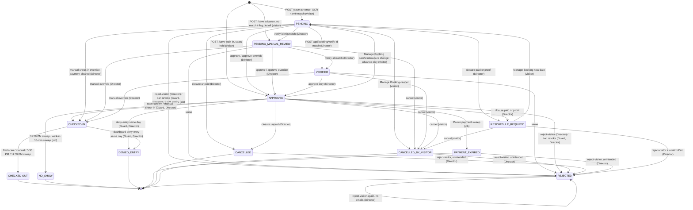

# AeroVisit audit: visitor journeys (Advance Booking and Walk-in)

Date: 2026-11-04. Scope: the code in the working tree on branch `main` (uncommitted changes included). No code, test or
setting was changed. No tests were run: the memory notes warn that `./mvnw test` on this project can crash a running
`spring-boot:run`, so every verdict comes from reading the code. CONFIRMED means traced line by line in the code.
PLAUSIBLE means it depends on timing or on the deployment and needs a real run to confirm.

The finecomb and backend-design (security-reviewer, incident-thinker) skills and agents aren't installed in this
environment, so the security and failure parts were done by hand.

**File references.** Java files live under `aerovisit/src/main/java/com/paf/aerovisit/` (in `controller/`, `service/`,
`model/`, `repository/`, `config/` or `security/`). Templates live under `aerovisit/src/main/resources/templates/`. File
names are unique, so this report gives only the file name and line, for example `VisitorPortalController.java:209`.
`fragments/visitor.html` is the template that holds the Terms and Privacy text.

---

## PART 1: THE FLOWS AS BUILT

`status` is `Visitor.status` and `pay` is `Visitor.paymentStatus` (`null` until something sets it).
"Bell" means a `NotificationService` event. "Email" means an `EmailService` method; `(outbox)` means it is sent in the
background through `MailOutbox`.

### 1A. Advance Booking

| # | Who | What happens | Endpoint / template | status / pay after | Emails / bell |
|---|---|---|---|---|---|
| 1 | Visitor | Opens the booking page. A one-time KYC nonce goes into the session and the form (`VisitorPortalController.java:152-154`). The calendar shows seats left, counting only APPROVED / CHECKED-IN / CHECKED-OUT (`:163`, `Visitor.java:196`); closed dates show 0 (`:176`). | `GET /` → `register.html` | none | none |
| 2 | Visitor | The Terms popup's one checkbox unlocks the steps and sets the hidden `termsAccepted` (`fragments/visitor.html:340-379`, `register.html:428`). This happens in the browser only; the server re-checks it in step 9. | none (client side) | none | none |
| 3 | Visitor | Picks the "Advance" card; `bookingType` stays empty (`register.html:126-136, 214`). | none | none | none |
| 4 | Visitor | Picks a date and time window in the 2-step picker (`register.html:600-633`); both are read-only form fields. | none | none | none |
| 5 | Visitor | Enters Discounted / Regular / Free counts (`register.html:354-377`). The page shows a total; the server ignores it and prices the counts itself (step 9). | none | none | none |
| 6 | Visitor | Fills in the representative's details. Only the fields listed in `VisitorPortalController.java:133-137` are bound. | none | none | none |
| 7 | Visitor | Requests the email code, then enters it. Code: 6 digits, valid 5 minutes, 5 tries, 60 s resend cooldown, 5 sends per email and 30 per IP per hour. Once verified, the email stays verified for 30 minutes (`OtpService.java:29-36`). | `POST /otp/send`, `POST /otp/verify` (`OtpController.java:30, 48`) | none | Email `sendOtpEmail` (synchronous, `OtpService.java:83`) |
| 8 | Visitor | Takes or uploads one ID photo; the page converts it to JPEG when it can (`register.html:929-1001`). | none | none | none |
| 9 | Visitor | Submits. `/save` runs its checks in this order: **(a)** nonce, burned whatever the outcome (`:209`, `:1079-1090`); **(b)** terms `"true"` (`:215`), then the time and version are recorded (`:219-220`); **(c)** walk-in only: date (skipped here); **(d)** emergency closure on the date (`:254`); **(e)** OTP verified for this email (`:260`); **(f)** active ban on the email or phone → refused with a neutral message, plus a `bannedContactAttempt` bell (`:268-273`); **(g)** another live booking for the same email and date (`:275-286`); **(h)** 4-hour cooldown after a REJECTED booking for that date (`:287-290`); **(i)** counts valid (`AdmissionPricing.java:67-72`), then priced at **today's** prices, with groupSize = the sum (`:294-300`); **(j)** walk-in only: window and max pax (skipped here); **(k)** seats: a pre-check (`:321-342`); a slot must exist and the date must not be past (`:1116-1121`); **(l)** ID photo: present, ≤ 15 MB, not HEIC, and the bytes must really be JPEG/PNG/WEBP and fully decode (`:354-358`, `:867-878`); **(m)** the photo is saved under a UUID name and mirrored to S3 (`:371-374`); **(n)** KYC/OCR (`KycService.java:92-127`): status PENDING when OCR reads both names, otherwise PENDING_MANUAL_REVIEW (`:386`); **(o)** face resembles a ban → PENDING_MANUAL_REVIEW, `possibleBanMatch`/`possibleBanId` set, `faceBanFlag` bell (`:387-393`); **(p)** same face on another booking that date → PENDING_MANUAL_REVIEW, `possibleDuplicateOf` set (`:397-401`); **(q)** name resembles a ban → PENDING_MANUAL_REVIEW plus the flag (`:410-418`); **(r)** a unique reference ID (`:421-425`); **(s)** save under the slot row lock (`:429`, `SeatReservationService.java:356-364`). **Note:** PENDING holds no seats, but the lock still refuses a group that doesn't fit the seats already held; **(t)** the OTP is consumed (`:442`). | `POST /save` → `redirect:/success-page` → `success.html` | **PENDING** or **PENDING_MANUAL_REVIEW** / pay `null` | Bell `bookingRequest` (`:446`); Email `sendPendingNotification` "Visit Request Received" (outbox, `:453-454`) |
| 10 | Director | Opens the Pending list. Approve (`GuardOperationController.java:487-559`) checks: not DENIED_ENTRY (`:494`); `awaitsApproval` (`:499`); **not banned by face or contact (`:506`)**; the slot exists (`:513`); seats remain (`:518`); payment step (`:524`). It then saves under the seat lock (`:536`). Force Approve (`:563-611`) skips the seat checks and accepts only PENDING / PENDING_MANUAL_REVIEW (`:573`). | `POST /admin/approve/{id}`, `POST /admin/approve-override/{id}` (`admin.html:396, 419`) | see 11a/11b | Bell `slotFilling` (`:549, :600`) |
| 11a | System | Total = 0: pay set to NOT_REQUIRED (`PaymentWorkflow.java:100-102`); QR file `QR_<id>.png` made from `secureToken` (`GuardOperationController.java:650-660`). | none | **APPROVED** / **NOT_REQUIRED** | Email `sendApprovalEmailWithQR` (outbox; on failure the `approvalEmailFailed` bell, `:664-670`) |
| 11b | System | Total > 0: billing number (row-locked counter, `BillingNumberService.java:555-567`), `paymentToken` (UUID), pay AWAITING_PAYMENT. Deadline = the EARLIER of now + window hours (default 48) and the window start (`PaymentWorkflow.java:106-112, 139-143`). Seats are held. | none | **APPROVED** / **AWAITING_PAYMENT** | Email `sendPaymentRequest` with the `/payment?token=` link (outbox; on failure the `approvalEmailFailed` bell, `GuardOperationController.java:636-639`) |
| 12 | Visitor | Opens the payment page from the email link, or from Manage Booking. It shows the billing number, amount, deadline, Landbank steps and the upload form; `Referrer-Policy: no-referrer` (`PaymentController.java:131-133`, `payment.html:5`). The visitor pays on Landbank, outside AeroVisit. | `GET /payment?token=` (`PaymentController.java:58`), `GET /manage-booking/payment` (`:72`) → `payment.html` | unchanged | none |
| 13 | Visitor | Uploads the receipt. Refused when: pay is PAID; status is neither APPROVED nor pending review; or the deadline has passed (a receipt already in review may still be replaced) (`PaymentWorkflow.java:160-169`). Receipt: ≤ 5 MB, signature + decode, `receipt-<uuid>`; the previous receipt is deleted (`ReceiptStorage.java:66-79`). | `POST /payment/proof` (`PaymentController.java:82-127`) | APPROVED / **PROOF_SUBMITTED** | Bell `paymentProofSubmitted` (`:122`). No email to the visitor. |
| 14a | Director | Mark as Paid. Works from PROOF_SUBMITTED, or with a required note from AWAITING / PAYMENT_REJECTED (`PaymentAdminController.java:117-122`). For an APPROVED advance booking the QR is made (`:134-142`). | `POST /admin/payments/{id}/verify` | APPROVED / **PAID** | Email `sendApprovalEmailWithQR` (outbox, `:148`) |
| 14b | Director | Reject Receipt with a reason. New deadline = the later of now + 24 h and the old deadline, capped at the window start (`PaymentWorkflow.java:146-151`). | `POST /admin/payments/{id}/reject` (`PaymentAdminController.java:159-191`) | APPROVED / **PAYMENT_REJECTED** | Email `sendPaymentRejected` (outbox; on failure the `rejectionEmailFailed` bell) |
| 15 | System | 7:00 AM the day before: reminder with the QR, for APPROVED bookings that have a QR (`AeroVisitAutomationEngine.java:59-79`). 6:30 AM on the day: the large-group bell (`:82-88`). | scheduled | unchanged | Email `sendReminderEmailWithQR`; Bell `arrivingToday` |
| 16 | Guard | Scans the QR (looked up by `secureToken`, `GuardOperationController.java:131`). The card shows the photo, headcount, admission and payment. Accept re-runs `checkInBlocker` (APPROVED, payment cleared, not banned, today, inside window −15 min .. end; `:339-367`) and then a status claim in one UPDATE (`:411`, `VisitorRepository.java:82-83`). Deny Entry → DENIED_ENTRY (`:466-485`). Without a QR, the guard can check in by reference ID (`:206-302`). | `scanner.html`, `POST /admin/api/scan`, `POST /admin/api/confirm-check-in`, `POST /admin/api/deny-entry`, `POST /admin/manual-checkin` | **CHECKED-IN** (or **DENIED_ENTRY**) | Email `sendCheckInGuidelines` (`:424`); Bell `gateDenied` on denial (`:483`) |
| 17 | Guard / System | Check-out: a second scan 2+ minutes after check-in (`:163-179`), manual check-out (`:230-238`), the 5:30 PM sweep for ended windows, or the 11:59 PM sweep for everything (`AeroVisitAutomationEngine.java:200-211, 287-296, 495-516`). | as above | **CHECKED-OUT** | see 18 |
| 18 | System | The feedback email goes out exactly once: at check-out, or from the 15-minute sweep G minutes (default 30) after the window ends, using a claim UPDATE (`FeedbackEmails.java:472-478, 499-515`; `VisitorRepository.java:87-90`; `Visitor.java:127`). The visitor submits feedback; the local AI labels its sentiment. | `GET /leave-feedback?token=<secureToken>` → `feedback.html`; `POST /submit-feedback` (`VisitorPortalController.java:975-1042`) | unchanged (rating saved) | Email `sendCheckOutFeedback`; Bell `negativeFeedback`; Email `sendCriticalFeedbackAlert` to the alert inbox |

### 1B. Walk-in (Today)

| # | Who | What happens | Endpoint / template | status / pay after | Emails / bell |
|---|---|---|---|---|---|
| 1 | Visitor | Availability (`WalkInService.java:221-256`): closed today → card disabled with the reason; no slots today; a window is offered only if it is ≥ 20 minutes before its end (`:259-261`) and has seats (`:239-241`). The card is disabled with the reason (`register.html:131-136`). | `GET /` | none | none |
| 2 | Visitor | Same form, Terms, counts, details, email code and ID photo. `bookingType=WALK_IN` (`register.html:765`). | none | none | none |
| 3 | Visitor | `/save` runs the same order as 1A step 9, plus: date forced to today; another date is refused (`VisitorPortalController.java:225-236`); window check (`WalkInService.java:264-277`); group ≤ max pax (default 20, `VisitorPortalController.java:310-314`). Status is set to APPROVED before the save (`:363`); `checkInDueAt` is set (`WalkInService.java:312-318`). KYC runs, but its result **never changes a walk-in's status** (`VisitorPortalController.java:386, 388, 399, 404, 414` are all `!walkIn`); flags are only recorded. Saved under the seat lock, so the seats are held at once (`:429`). | `POST /save` | **APPROVED** / `null`, bookingCategory **WALK_IN** | Bell `faceBanFlag` if the face is flagged. No `bookingRequest` bell; no pending email. |
| 4a | System | Total = 0 (`:463-468`). | → `success.html` with `walkInGate` | APPROVED / **NOT_REQUIRED** | **No email at all** (see L6) |
| 4b | System | Total > 0: billing number, token, AWAITING_PAYMENT. Deadline = the EARLIER of now + walk-in minutes (default 30) and the window end (`PaymentWorkflow.java:117-127`, `WalkInService.java:298-300`). The browser is signed into Manage Booking with a new session ID (`VisitorPortalController.java:475, 480-486`). | → `redirect:/manage-booking/payment` → `payment.html` | APPROVED / **AWAITING_PAYMENT** | Email `sendPaymentRequest` (walk-in subject, outbox, `:472-474`) |
| 5 | Visitor | Pays on Landbank, then uploads the receipt (same as 1A step 13). | `POST /payment/proof` | APPROVED / **PROOF_SUBMITTED** | Bell `paymentProofSubmitted` |
| 6 | Guard | Walk-ins Today tab (`GuardDashboardController.java:44-92`, `guard.html:139-226`). Opens the receipt: allowed for a Guard only on a walk-in dated today (`PaymentAdminController.java:65-69, 84-98`). Mark as Paid needs the "Billing number and amount match" tick and PROOF_SUBMITTED (`:114-116`, `guard.html:314`). Or Reject: new deadline = the later of now + walk-in minutes and the old deadline, capped at the window end (`WalkInService.java:303-307`). | `POST /admin/payments/{id}/verify`, `.../reject` | APPROVED / **PAID** or **PAYMENT_REJECTED** | Email `sendPaymentRejected` on rejection. No QR or email on Paid (`PaymentAdminController.java:133-146`). |
| 7 | Guard | Ban-flag tick: when `possibleBanMatch` is set and nobody has ticked it yet (`Visitor.java:466`), the Check In form requires "ID checked against the ban" (`guard.html:215-217`, `GuardOperationController.java:279-282, 327-329`). **A face flag can't be cleared this way; see H1.** | none | none | none |
| 8 | Guard | Check In from Walk-ins Today, by reference ID through manual check-in (`guard.html:212-219` → `GuardOperationController.java:206-297`). `banCheckedBy`/`banCheckedAt` are recorded (`:332-337`). | `POST /admin/manual-checkin` | **CHECKED-IN** | Email `sendCheckInGuidelines` (outbox, `:292-294`) |
| 9 | Guard / System | Check-out and feedback, as 1A steps 17-18. | none | **CHECKED-OUT** | Feedback email |

### 1C. Side paths

- **Receipt rejected, then re-uploaded.** Rejecting sets PAYMENT_REJECTED, saves the reason and a new deadline, and emails the visitor (`PaymentAdminController.java:176-186`). The upload stays open until that deadline (`PaymentWorkflow.java:165-166`). The new receipt replaces the old file (`ReceiptStorage.java:77`); pay → PROOF_SUBMITTED; the reason is cleared (`PaymentController.java:118-120`).
- **Payment deadline expiry.** Every 15 minutes, an APPROVED booking with pay AWAITING_PAYMENT or PAYMENT_REJECTED whose deadline has passed → **PAYMENT_EXPIRED**, QR cleared, `sendPaymentExpired` sent **synchronously**, bell `paymentExpired` (`AeroVisitAutomationEngine.java:222-262`). Advance deadline = min(approval + 48 h, window start). Walk-in deadline = min(booked + 30 min, window end). PROOF_SUBMITTED is never expired automatically (`:220`). An advance booking the Director never verifies becomes NO_SHOW at 11:59 PM; a walk-in becomes NO_SHOW at `checkInDueAt` = window end.
- **Free walk-in check-in deadline.** `checkInDueAt` = (the later of now and the window start) + walk-in minutes, capped at the window end (`WalkInService.java:312-318`). The 15-minute sweep sets NO_SHOW (`AeroVisitAutomationEngine.java:237-247`). The gate itself doesn't check `checkInDueAt` (L9).
- **No-show sweep, 11:59 PM.** APPROVED bookings whose window has ended → NO_SHOW (`AeroVisitAutomationEngine.java:521-539`). At 2:00 AM, requests that were never reviewed and whose date has passed → REJECTED with an "expired" reason. **No email** (`:367-377`).
- **Manage Booking changes.** Sign-in needs email + reference ID (`VisitorPortalController.java:620-633`). An advance booking can be edited while PENDING, APPROVED or RESCHEDULE_REQUIRED (not while PENDING_MANUAL_REVIEW or VERIFIED); a walk-in only while RESCHEDULE_REQUIRED (`:844-848`).
  - **Before payment:** counts can change and are re-priced at the unit prices stored on the booking (`:698, 1063-1067`).
  - **After payment, or while a receipt is in review:** counts are locked (`:855-863`), but date and window can still change.
  - Changing date, window or size on an APPROVED booking → **PENDING**, QR cleared, reminder reset, payment kept (`:777-783`); bell `bookingRescheduled` (`:785-787`).
  - Changing only the categories at the same size skips all of that (M1).
- **Visitor cancellation.** Allowed from PENDING, PENDING_MANUAL_REVIEW, VERIFIED, APPROVED or RESCHEDULE_REQUIRED on a date that hasn't passed (`:850-852`). If paid or proof submitted, the "non-refundable" tick is required (`:811-814`). → **CANCELLED_BY_VISITOR**, QR cleared, bell `bookingCancelled`. No email to the visitor.
- **Director rejects a paid booking.** Works through `/admin/reject-visitor` (the form in `admin.html:465`); requires `confirmPaid` when pay is PAID or PROOF_SUBMITTED (`ManagementController.java:121-124`). → **REJECTED**; pay stays PAID; `sendRejectionEmail` (outbox; on failure the `rejectionEmailFailed` bell). A second endpoint, `/admin/reject/{id}`, does the same without a reason or email; no template uses it (`GuardOperationController.java:727-753`).
- **Emergency closure.** The closure row is saved first (`ManagementController.java:410-411`). Bookings on that date that are APPROVED / PENDING / PENDING_MANUAL_REVIEW / VERIFIED become: paid with a total above 0, or with proof submitted → **RESCHEDULE_REQUIRED**; everything else → **CANCELLED**. QR cleared, `saveAll`, then each email is sent **synchronously** and failures are counted (`:415-450`). The visitor then picks a new date in Manage Booking (it must differ from the old one, `VisitorPortalController.java:761-765`) → **PENDING**, payment kept. A rescheduled walk-in becomes an Advance booking: `bookingCategory` and `checkInDueAt` are cleared (`:772-776`). On approval: PAID → QR at once; PROOF_SUBMITTED → waits for verification (`PaymentWorkflow.java:104-105`).
- **Price change after booking.** `AdmissionPricing.save` (`AdmissionPricing.java:52-57`). Existing bookings keep their stored unit prices and total (`Visitor.java:151-156`). New bookings and walk-ins are priced at submit time with `currentPrices()` (`VisitorPortalController.java:300`), so the total shown when the page loaded (`:155`) can differ without notice. The real amount appears in the payment email and on the payment page.
- **AI switched off or unreachable.** `KycService.screen` returns PENDING_MANUAL_REVIEW with no face (`KycService.java:93-98`), so the face-ban and duplicate-face checks don't run. The email/phone ban and the name flag still work (`VisitorPortalController.java:268-273, 410-418`). Walk-ins are still APPROVED. Bell `aiServiceOffline`. Time limit: 20 s per request plus a 10 s connect timeout (`KycService.java:64, 73`). After a failure, `AiSwitch.reportUnreachable` makes later bookings skip the call.

---

## PART 2: STATE MACHINE

### 2A. Booking status



Writers of each status: `VisitorPortalController.java:348, 363, 386-414, 780, 815`; `GuardOperationController.java:173,
233, 288, 419, 477, 529, 598, 748`; `ManagementController.java:137, 308, 420, 423`; `IdVerificationController.java:65,
71`; `AeroVisitAutomationEngine.java:241, 254, 371, 506, 532`. `CANCELLED_OVERRIDE` has no writer any more. It is legacy
and handled read-only everywhere.

### 2B. paymentStatus

```mermaid
stateDiagram-v2
    [*] --> NULL_ : POST /save advance (pay not set)
    [*] --> NOT_REQUIRED : POST /save walk-in, total 0
    [*] --> AWAITING_PAYMENT : POST /save walk-in, total above 0 (billing number, token)
    NULL_ --> NOT_REQUIRED : approve, total 0 (Director)
    NULL_ --> AWAITING_PAYMENT : approve, total above 0 (Director)
    AWAITING_PAYMENT --> AWAITING_PAYMENT : re-approval after reschedule, new deadline (Director)
    AWAITING_PAYMENT --> PROOF_SUBMITTED : POST /payment/proof (visitor, token or session)
    PAYMENT_REJECTED --> PROOF_SUBMITTED : POST /payment/proof before deadline (visitor)
    PROOF_SUBMITTED --> PROOF_SUBMITTED : replace receipt (visitor)
    PROOF_SUBMITTED --> PAYMENT_REJECTED : reject receipt (Director; Guard for walk-in today)
    PROOF_SUBMITTED --> PAID : verify (Director; Guard walk-in today + match tick)
    AWAITING_PAYMENT --> PAID : verify with note, no receipt (Director)
    PAYMENT_REJECTED --> PAID : verify with note (Director)
    PAYMENT_REJECTED --> AWAITING_PAYMENT : re-approval after reschedule (Director)
    NOT_REQUIRED --> NOT_REQUIRED : same-size category swap to a total above 0 (visitor), see M1
    PAID --> [*]
```

`NULL_` stands for `null`. Writers: `PaymentWorkflow.java:101, 108, 119, 124`; `PaymentController.java:119`;
`PaymentAdminController.java:128, 176`; `VisitorPortalController.java:464`. The booking status moves independently. For
example, PAYMENT_EXPIRED keeps pay AWAITING_PAYMENT or PAYMENT_REJECTED, and REJECTED keeps PAID.

### 2C. Stuck states (reachable, never left)

1. **RESCHEDULE_REQUIRED.** Only the visitor can leave it. No job reminds them. After 30 days the purge anonymizes the
   row (`AeroVisitAutomationEngine.java:306-308, 444-449`), so their email no longer matches and they can't sign in to
   Manage Booking any more (`VisitorPortalController.java:625`). The paid booking is then stuck for good (M5).
2. **APPROVED + NOT_REQUIRED with a total above 0.** Produced by M1. The visitor can't pay (no billing number,
   `PaymentController.java:101`), the Director can't verify ("not waiting for a payment", `PaymentAdminController.java:267-269`),
   and the gate refuses entry (`GuardOperationController.java:344`). It only ends as NO_SHOW.
3. **APPROVED + PROOF_SUBMITTED (advance) that the Director never verifies.** Not expired, by design
   (`AeroVisitAutomationEngine.java:220`). The visitor has paid but has no QR. It becomes NO_SHOW at 11:59 PM of the visit
   day, with no warning except the original `paymentProofSubmitted` bell.
4. **Walk-in with a face-ban flag.** APPROVED, possibly PAID, but every check-in is refused (H1). It ends as NO_SHOW at
   `checkInDueAt`.
5. Terminal by design: CHECKED-OUT, NO_SHOW, DENIED_ENTRY, PAYMENT_EXPIRED, CANCELLED, CANCELLED_BY_VISITOR, REJECTED
   (re-booking is allowed after the cooldown).

### 2D. Transitions the code allows that the design doesn't intend

- CANCELLED_BY_VISITOR, CANCELLED, PAYMENT_EXPIRED or REJECTED → REJECTED through `/admin/reject-visitor` or
  `/admin/reject/{id}`. Only DENIED_ENTRY and CHECKED-IN / CHECKED-OUT / NO_SHOW are guarded
  (`ManagementController.java:125-135`, `GuardOperationController.java:738-746`). The `/admin/reject-visitor` path also
  emails a "not approved" notice (L3).
- APPROVED (free) → still APPROVED with a total above 0 and no re-approval, after a category swap at the same size (M1).
- APPROVED → APPROVED again after a reschedule, reusing the old QR token, although the visitor was told the old QR "is no
  longer valid" (L5).
- An advance booking can be created and approved for a window that already ended today (L1).
- Concurrent stale saves can resurrect or overwrite a status (M4).

### 2E. Status coverage check

| Place | Result |
|---|---|
| `checkInBlocker` (`GuardOperationController.java:339-351`) | Every status except APPROVED is refused with a generic message that includes the raw status. Correct. |
| `manualCheckIn` (`:216-297`) | Explicit branches for CHECKED-OUT, DENIED_ENTRY, REJECTED/CANCELLED*, PAYMENT_EXPIRED, RESCHEDULE_REQUIRED, NO_SHOW. PENDING/PENDING_MANUAL_REVIEW/VERIFIED: Director override only (`:241`). Complete. |
| Scan (`:153-192`) | CHECKED-OUT, REJECTED, DENIED_ENTRY explicit; the rest go through `checkInBlocker`. Complete. |
| Manage Booking edit (`VisitorPortalController.java:844-848`) | Excludes PENDING_MANUAL_REVIEW and VERIFIED. The comment at `:841-842` says "while PENDING or APPROVED", so this matches the comment; a flagged visitor can only cancel. |
| Manage Booking cancel (`:850-852`) | Complete. |
| Sweeps | Payment: APPROVED + AWAITING_PAYMENT/PAYMENT_REJECTED only. A PENDING booking with AWAITING_PAYMENT (rescheduled) is ignored until re-approval or the 2 AM expiry. No-show: APPROVED only. Walk-in: APPROVED + WALK_IN only. RESCHEDULE_REQUIRED: no sweep (2C.1). |
| Retention purge (`AeroVisitAutomationEngine.java:306-308`) | Includes every terminal status and RESCHEDULE_REQUIRED (2C.1 / M5). PENDING, APPROVED and CHECKED-IN reach a purgeable status first. |
| `SEAT_HOLDING_STATUSES` (`Visitor.java:196`) | APPROVED, CHECKED-IN, CHECKED-OUT. Used consistently by the calendar, /save, approval, the seat lock, walk-ins and Manage Booking. |
| Seat-free / face-free sets | `SEAT_FREE_STATUSES` (`VisitorPortalController.java:542-543`) and the /save email rule (`:278-279`) both include PAYMENT_EXPIRED. `FACE_FREE_STATUSES` (`:551`) does **not** (L4). NO_SHOW, DENIED_ENTRY and RESCHEDULE_REQUIRED block re-booking the same date in all three. That is consistent. |
| Labels and badges | `visitorStatusLabel`/`Tone` (`:895-923`) and `admin.html:368-379` cover every status. |
| Excel export (`AdminDashboardController.java:912-1047`) | Writes the raw status, so every status appears. Separate defect: the phone column (L8). |

---

## PART 3: SECURITY AND PERMISSIONS

### 3A. Permission matrix

Columns: **Anon** = anonymous; **Token** = visitor holding a payment token or secureToken; **MB** = visitor with a Manage
Booking session (+ `formToken` for POSTs); **G** = Guard; **D** = Director. ✓ allowed, ✗ denied, ~ allowed with
conditions. CSRF is on for every POST except `/save` (`SecurityConfig.java:44`).

| Endpoint | Anon | Token | MB | G | D | Enforced at |
|---|---|---|---|---|---|---|
| `GET /` | ✓ | ✓ | ✓ | ✓ | ✓ | `SecurityConfig.java:47` |
| `POST /save` | ~ session nonce + OTP | ~ | ~ | ~ | ~ | `SecurityConfig.java:47`; `VisitorPortalController.java:209, 260` |
| `POST /otp/send`, `/otp/verify` | ✓ | ✓ | ✓ | ✓ | ✓ | `SecurityConfig.java:54`; limits in `OtpService.java:29-36` |
| `GET /check-status` | ~ email + ref | ~ | ~ | ~ | ~ | `VisitorPortalController.java:496-529` |
| `POST /manage-booking/login` | ~ email + ref | ~ | ~ | ~ | ~ | `VisitorPortalController.java:620-633` |
| `GET /manage-booking` | sign-in form | sign-in form | own booking | form | form | `:587-618` (reads the id from the session) |
| `POST /manage-booking/update`, `/cancel` | ✗ | ✗ | ~ own booking + formToken | ✗ | ✗ | `:832-839` |
| `GET /manage-booking/payment` | ✗ (redirect) | ✗ | own booking | ✗ | ✗ | `PaymentController.java:72-80, 142-146` |
| `GET /payment?token=` | ✗ invalid-link page | own booking | ✗ | ✗ | ✗ | `PaymentController.java:58-70, 136-139` |
| `POST /payment/proof` | ✗ | ~ own token | ~ own + formToken | ✗ | ✗ | `PaymentController.java:88-97` |
| `GET /leave-feedback`, `POST /submit-feedback` | ✗ | ~ secureToken, visit over, once | ✗ | ✗ | ✗ | `VisitorPortalController.java:970-1002` |
| `GET /admin` (manifest) | ✗ login | ✗ | ✗ | redirected to the Guard Dashboard | ✓ | `AdminDashboardController.java:97-102` |
| `POST /admin/approve/{id}`, `/admin/reject/{id}`, `/admin/reject-visitor` | ✗ | ✗ | ✗ | ✗ 403 | ✓ | `SecurityConfig.java:105` |
| `POST /admin/approve-override/{id}` | ✗ | ✗ | ✗ | ✗ | ✓ | `SecurityConfig.java:101` |
| `GET /admin/payments/{id}/receipt` | ✗ | ✗ | ✗ | ~ walk-in dated today | ✓ | `SecurityConfig.java:79`; `PaymentAdminController.java:65-69` |
| `POST /admin/payments/{id}/verify` | ✗ | ✗ | ✗ | ~ walk-in today + PROOF_SUBMITTED + match tick | ✓ (note-only too) | `PaymentAdminController.java:111-116` |
| `POST /admin/payments/{id}/reject` | ✗ | ✗ | ✗ | ~ walk-in today | ✓ | `:167` |
| `POST /admin/settings/payment`, `/walk-in`, `/admission-prices`, `/feedback` | ✗ | ✗ | ✗ | ✗ | ✓ | `SecurityConfig.java:81, 84, 98` |
| `GET /admin/scanner`, `POST /admin/api/scan`, `/admin/api/confirm-check-in`, `/admin/api/deny-entry`, `/admin/deny-entry` | ✗ | ✗ | ✗ | ✓ | ✓ | catch-all `SecurityConfig.java:112` (intended) |
| `POST /admin/manual-checkin` | ✗ | ✗ | ✗ | ~ APPROVED only | ✓ incl. pending override | `:112`; `GuardOperationController.java:241` |
| `POST /admin/biometric-ban/{id}` | ✗ | ✗ | ✗ | ✓ | ✓ | catch-all (intended, per `SecurityConfig.java:111`) |
| `POST /admin/bans/{id}/lift` | ✗ | ✗ | ✗ | ✗ | ✓ | `SecurityConfig.java:88` |
| `POST /admin/slots/closure/execute` | ✗ | ✗ | ✗ | ✗ | ✓ | `SecurityConfig.java:87` (`/admin/slots/**`) |
| `POST /admin/delete/{id}`, `GET /admin/export-excel` | ✗ | ✗ | ✗ | ✗ | ✓ | `SecurityConfig.java:87-88` |
| `POST /api/booking/verify-id` | ✗ | ✗ | ✗ | ✗ | ✓ | `SecurityConfig.java:106` |
| `GET /guard/dashboard` | ✗ | ✗ | ✗ | ✓ | ✓ | `SecurityConfig.java:109` |
| `GET /uploads/**` (ID photos, face crops, QR, ban mugshots) | ✗ | ✗ | ✗ | ✓ **all of them** | ✓ | `SecurityConfig.java:75` |
| `GET /uploads/receipt-*` | ✗ | ✗ | ✗ | ✗ | ✗ | `SecurityConfig.java:72` |

**Accidental Guard catch-all.** None of the /admin paths in these journeys falls through to the Guard catch-all by
mistake. Guards also reach `GET /admin/settings` and `GET /admin/calendar` through the catch-all, but their
Director-only panels are hidden with `th:if="${isDirector}"` (`settings.html:77, 116, 161, 190, 268`), and every POST
behind them is Director-only. The Guard's `/uploads/**` access covers every advance booking's ID photo and face crop,
not only today's (see 5 and L12).

### 3B. IDOR (insecure direct object references)

- Manage Booking update and cancel read the booking ID from the session, never from the request
  (`VisitorPortalController.java:833-838`). The payment page and upload do the same (`PaymentController.java:142-152`).
  **No IDOR.**
- `/payment?token=` opens only the booking whose token matches, and only while the total is above 0
  (`PaymentController.java:136-139`). The billing number never opens anything.
- Receipts: there is no public path (`SecurityConfig.java:72`). The staff path checks the role and the booking
  (`PaymentAdminController.java:65-69`).
- Feedback: the secureToken is a UUID. It also lets the holder read the visitor's name on the form (`feedback.html`).
  The same token is printed in the QR, so anyone who saw or photographed a group's QR can submit that booking's single
  review once the visit is over. This is a minor exposure, not listed as a finding.
- `/check-status` and Manage Booking sign-in need email + reference ID (32^6 ≈ 1.07 billion values, `SecureRandom`,
  `ReferenceIdGenerator.java:8-23`). They are rate limited per IP (`RateLimitFilter.java:43-44`), but see M3.

### 3C. Tokens

| Token | Created | Sent / shown | In URLs | Logged | Stops working |
|---|---|---|---|---|---|
| `secureToken` (QR + feedback) | Entity default (`Visitor.java:52`), ensured at `/save` (`VisitorPortalController.java:249-251`) | QR PNG attached to the approval and reminder emails (`GuardOperationController.java:653-656`); feedback link (`EmailService.java:157`) | `/leave-feedback?token=` | No | **Never rotated**, not even on reschedule (L5) or by the purge. The scan accepts it only while APPROVED and inside the window; feedback once, after the visit. |
| `paymentToken` | At approval or a paid walk-in (`PaymentWorkflow.java:107, 123`) | Payment emails (`EmailService.java:416`); hidden field (`payment.html:109`) | `/payment?token=` and the redirect after upload (`PaymentController.java:98`) | No (labels leave it out, `FeedbackEmails.java:490-493`, `PaymentController.java:114`) | Never while the total is above 0. After PAID or expiry the page still opens read-only (it shows the reference ID, billing number, date and amount); uploads are refused by `uploadBlocker`. The purge doesn't clear it. `Referrer-Policy: no-referrer` header + meta. |
| KYC nonce | Every render of `/` (`VisitorPortalController.java:152-154`) | Hidden field | No | No | Burned on the first `/save` attempt (`:1079-1090`) |
| Manage `formToken` | Sign-in or walk-in auto sign-in (`:485`) | Hidden fields | No | No | Logout or session expiry |
| OTP code | `OtpService.java:138` | Email | No | No | 5 minutes / 5 tries; once verified, valid 30 minutes; consumed by a booking (`:189-191`). In memory only, so a restart loses it. |
| Reference ID | `VisitorPortalController.java:421-425` | Pending, approval and closure emails; success page; **payment page** | `GET /check-status?email=&referenceId=` puts both credentials in the query string (browser history, proxy logs) | `VisitorPortalController.java:573` logs it for duplicate-face matches | Never |

`EmailService.java` prints recipient email addresses to stdout on every send (`:212, 237, 253, 316, 330, 366, 386, 399,
436, 447, 458`). That is personal data in the server logs; tokens are not printed.

### 3D. Uploads

- **ID photo.** ≤ 15 MB (`VisitorPortalController.java:112, 869`; multipart limit `application.properties:114-115`).
  HEIC is refused with its own message (`ReceiptStorage.java:32-37`). The format is read from the signature, the image
  must fully decode, and dimensions are capped at 10,000 px with subsampling, so a decompression bomb is refused
  (`ExhibitPhotoStorage.java:143-164`; WebP through TwelveMonkeys, `pom.xml:162-168`). Name: UUID + an extension taken
  from the original file name, restricted to jpg/jpeg/png/webp (`VisitorPortalController.java:1105-1113`). The
  extension may not match the real format; that is harmless because the content was validated. Viewers: Guard and
  Director through `/uploads/**`. Mirrored to S3 (`:374`). Purged 30 days after the visit (`AeroVisitAutomationEngine.java:413-416`).
- **Face crop** `faceid-<uuid>.png`: the same viewers, mirror and purge (`:417-420`). **Not removed by Delete (M6).**
- **Receipt.** ≤ 5 MB, same checks, the name comes from the real format (`ReceiptStorage.java:66-79`). Served only
  through `PaymentAdminController.receipt` with `no-store` and `nosniff` (`PaymentAdminController.java:92-97`). Mirrored
  to S3. Purged (`AeroVisitAutomationEngine.java:422-425`). **Not removed by Delete (M6).**
- If a refused `/save` had already stored its files, it removes them (`VisitorPortalController.java:432-439`). An
  unexpected exception from `saveWithinCapacity` (not the two exceptions caught) leaves them orphaned.

### 3E. Trust of browser input

Server-controlled: price, total, groupSize (`VisitorPortalController.java:131-138, 294-300`); status, tokens, reference
ID, category (`:223-236`); terms version (`:220`). Validated: date (slot must exist, date not past), window (slot must
exist), walk-in date / window / pax. **Not validated:**

- **The category split.** Free/Discounted eligibility is self-declared. Only the guard's eye at the gate checks it.
- **"Already at the museum?"** Anyone, anywhere, can choose Walk-in for today. That skips the Director's review
  entirely (M2).
- **A window that already ended today** on an advance booking (L1).

### 3F. Abuse

- **Blocking seats** with walk-ins (instant seat hold, no review) or with free categories (no payment step): M2.
- **Spamming bookings.** Each booking needs a fresh OTP for an inbox; limits are 5 per email and 30 per IP per hour
  (`OtpService.java:33-34`) and 20 `/save` per IP per 10 minutes (`RateLimitFilter.java:42`). A catch-all domain gets
  around the email limit; the IP limits can be bypassed where M3 applies.
- **Re-using a receipt.** Nothing compares receipt files across bookings. Defense is the human check that the billing
  number on the receipt matches (`guard.html:312-315`). Accepted risk, not listed as a finding.
- **Guessing billing numbers.** They are sequential (`BillingNumberService.java:569-571`) but grant nothing. Correct.
- **Rate limits:** see M3 for the CloudFront header.

### 3G. CSRF, Referrer-Policy, error messages

- CSRF is on (`SecurityConfig.java:44`). Every staff form carries `_csrf` (`admin.html:466, 572`, `guard.html:268, 307,
  335`, the `th:action` forms) and the fetch calls send the header (`register.html:850`, `fragments/shell.html:30-31`).
  `/save` relies on the session-bound nonce, and the session cookie is `SameSite=Strict` (`application.properties:14`).
  Correct. Outside this journey: `GET /admin/inject-mock-data` changes data through a GET request.
- Referrer-Policy: the payment pages set it (`PaymentController.java:131-133`, `payment.html:5`). `/leave-feedback`
  carries a token in its URL and sets no policy; browsers default to `strict-origin-when-cross-origin`, so the token
  isn't sent cross-site.
- Error messages: the public refusals are generic (ban `KycService.java:38`; Manage sign-in). Stack traces and messages
  are off (`application.properties:123-126`). The exception to "silent security" is the gate text "ACCESS DENIED: This
  visitor is banned." shown to a face-flagged look-alike (H1). Staff-only responses echo exception messages
  (`IdVerificationController.java:78`, `GuardOperationController.java:555`); low risk.

---

## PART 4: CONCURRENCY AND FAILURE

### 4A. Races

| Race | Result | Where |
|---|---|---|
| Two approvals for the last seats | Safe: the slot row lock + re-count inside it; the loser gets "Not enough seats" and its QR file is deleted | `SeatReservationService.java:355-364`, `GuardOperationController.java:536-547` |
| Two walk-ins for the last seats | Safe: same lock (`VisitorPortalController.java:429-441`) | as above |
| Billing numbers | Safe: `SELECT ... FOR UPDATE` in `REQUIRES_NEW`; the column is unique | `BillingNumberService.java:555-567`, `Visitor.java:168` |
| Two gates checking in or out | Safe: a conditional UPDATE claim (`VisitorRepository.java:82-83`), then a save of the entity | `GuardOperationController.java:283, 411` |
| Feedback email | Safe: claim UPDATE + `updatable=false` | `VisitorRepository.java:87-90`, `Visitor.java:127` |
| Sweep vs guard action | **Unsafe**: whole-entity saves with no version (M4) | `AeroVisitAutomationEngine.java:239-244` |
| Receipt upload at the deadline | **Unsafe** at the sweep tick (M4) | `PaymentController.java:100-121` vs `AeroVisitAutomationEngine.java:251-256` |
| Two `/save` calls with the same email and date | The email-duplicate check isn't under a lock, so both can pass when the windows differ (different lock rows). Minor; the same-face flag (with AI on) is the backstop. | `VisitorPortalController.java:275-286` |

### 4B. Stale-entity saves

`Visitor` has no `@Version` and no `@DynamicUpdate` (grep found neither), so every `repo.save(v)` writes every column
from the copy loaded at the start of the request or loop. Concrete overwrite cases are listed under M4.

### 4C. Failures

- **Email fails.** Approval, payment-request, payment-rejected and rejection emails report to the bell
  (`GuardOperationController.java:664-670, 636-639`; `PaymentAdminController.java:184-186`;
  `ManagementController.java:148-150`). Pending, reminder, check-in, feedback and payment-expired emails are only
  logged. Closure emails are counted on the page (`ManagementController.java:432-449`). OTP failure is shown to the
  visitor (`OtpController.java:43-44`).
- **S3 down.** `pushUpload` logs and carries on (`UploadMirror.java:100-104`), so the file exists locally only and is
  lost when the instance is replaced. The purge keeps a field whose S3 delete failed and retries it
  (`AeroVisitAutomationEngine.java:465-467`). Correct.
- **AI slow or off:** see Part 1C. Each `/save` can wait up to about 30 s on one request thread before
  `AiSwitch.reportUnreachable` trips.
- **Server restart during a sweep.** Each row is saved on its own (no transaction around the loop), so the next tick
  resumes. A crash between the PAYMENT_EXPIRED save and the synchronous expiry email loses that email. `MailOutbox` is
  in memory and is drained for 30 s on a clean shutdown only (`MailOutbox.java:66-71`); a crash loses queued emails
  without calling their failure callback (L10).
- **Two server instances.** Each instance runs every `@Scheduled` job (`AerovisitApplication.java:10`; no ShedLock), so
  the reminder, payment-expired and daily-report emails go out twice. OTP codes are in memory per instance
  (`OtpService.java:61`). The KYC nonce and the Manage session need sticky sessions. Rate-limit counters are per
  instance. GateClaim, the feedback claim, the billing lock and the seat lock are safe across instances (L11).

### 4D. Time zones and windows

- The JVM time zone is pinned to Asia/Manila in a `@PostConstruct` (`AerovisitApplication.java:17-20`) and in the
  Docker `TZ` (`Dockerfile:14-15`). The default local JDBC URL still says `serverTimezone=UTC`
  (`application.properties:27`). The Dockerfile notes an earlier "dates saved a day early" bug, so the production
  `DB_URL` should be checked.
- Windows can't cross midnight (`GuardOperationController.java:382`). A window ending 11:59 PM is caught by the next
  night's no-show sweep (`AeroVisitAutomationEngine.java:284-286`). Its feedback email is never sent by the 15-minute
  sweep, which looks at today only (`FeedbackEmails.java:503`); the 11:59 PM auto check-out sends it instead.
- An unreadable older window: the gate doesn't block it (`GuardOperationController.java:358`); its payment deadline is
  midnight at the start of the visit day (`PaymentWorkflow.java:132-136`), so an older booking approved on its own day
  expires at the next sweep.
- A booking approved after its window started or ended: allowed, with a deadline in the past (L1).
- Free walk-in deadlines are enforced by the 15-minute sweep, not the gate (L9).

---

## PART 5: DATA PRIVACY

| Data | Journey | Stored where | Who can see it | Deleted when |
|---|---|---|---|---|
| Name, sex, age, address, affiliation, visitor type, contact number, email, purpose, special consideration | both | `visitor` row | Director (manifest, export); Guard (Guard Dashboard: names, group, ID photo; the walk-in tab shows no contact details, `guard.html:139`) | Anonymized 30 days after the visit for purgeable statuses (`AeroVisitAutomationEngine.java:444-457`). Sex, age, affiliation, type, purpose, feedback and reference ID are kept. Delete removes the row. |
| ID photo | both | `uploads/<uuid>.<ext>` + S3 | Guard and Director, any booking (`SecurityConfig.java:75`) | Purge at 30 days; Delete (`ManagementController.java:92`) |
| ID face crop (biometric picture) | both | `uploads/faceid-<uuid>.png` + S3 | Guard and Director | Purge at 30 days. **Delete doesn't remove it (M6).** |
| Face template (128 floats) | both, AI on | `visitor.face_encoding` | Not shown | Purge at 30 days (`AeroVisitAutomationEngine.java:428-431`); Delete removes the row |
| OCR result | both | `ocr_name_match` boolean only; the OCR text isn't stored | Director | With the row |
| Payment receipt | paid | `uploads/receipt-<uuid>` + S3 | Director; Guard for today's walk-ins | Purge at 30 days; replaced on re-upload. **Delete doesn't remove it (M6).** |
| Billing number, amount, verifier, note | paid | `visitor` row | Director (export) | Kept after anonymization (audit) |
| Terms version and time | both | `visitor` row | Director (export) | Kept |
| Ban record: face template, email, phone, name, mugshot (a copy of the face crop, never the whole ID, `ManagementController.java:196-200`) | after a ban | `blacklisted_faces` + `uploads/ban-<uuid>` | Guard and Director | Temporary bans: deleted with the mugshot the night after expiry (`AeroVisitAutomationEngine.java:384-394`). Permanent bans: never. Lift removes them. |
| Gate denial reason | gate | `visitor` row | Director | Kept (it may contain free-text notes) |
| Feedback and sentiment | after the visit | `visitor` row | Director | Kept |
| Chat logs | chatbot | `chat_logs` | Director | 30 days (`AeroVisitAutomationEngine.java:353-361`) |
| Email addresses in stdout logs | all emails | server logs | Whoever reads the logs | Log retention (not managed by the app) |

**Privacy notice vs code** (`fragments/visitor.html:199-260`):

- §2: "A possible match is never acted on automatically". **False for face matches.** Approval and the gate refuse them
  automatically (H1).
- §2: "your ID photo and face template are never sent to any outside service". The AI service is the museum's own
  server, so that is accurate. But ID photos, face crops and receipts are copied to AWS S3
  (`VisitorPortalController.java:374, 887`; `ReceiptStorage.java:76`), and §3 lists only Google as a service provider
  (L12).
- §1 doesn't mention **payment receipt screenshots** or **billing and payment records** at all (L12).
- §4: "ID photos and face templates ... deleted automatically 30 days after the visit date". This matches the purge,
  except for Delete (M6) and RESCHEDULE_REQUIRED rows, which are anonymized while still "open" (M5).
- §5: "need-to-know". Guards can open every booking's ID photo, not just today's (`SecurityConfig.java:75`; L12).
- `register.html:414` "Only museum staff see it, and it is deleted 30 days after your visit" matches, with the same Delete
  caveat.

---

## PART 6: FINDINGS

Ranked by severity. No Critical findings: no path lets an anonymous user reach another visitor's data, and none lets
someone enter without the guard's checks.

| ID | Title | file:line | What goes wrong | Steps to reproduce | Impact | Suggested fix | Verdict |
|---|---|---|---|---|---|---|---|
| **H1** | A face-ban "flag" is enforced as a hard refusal at approval and at the gate | `GuardOperationController.java:251, 346, 506, 579, 722-725`; `IdentityBans.java:250-254`; vs `VisitorPortalController.java:387-393`, `KycService.java:26-29`, `fragments/visitor.html:224-225` | `/save` only flags an ID face that resembles a ban (cosine ≥ 0.363). But `isBanned()` uses the same `FaceEncodings.activeBan` on the same face, so Approve, Force Approve, the scan, confirm and manual check-in all refuse. The "ID checked against the ban" tick only clears name flags; `isBanned` runs before `banCheckMissing` (`:251` vs `:279`). | Ban visitor A (face on file). Visitor B, a look-alike or anyone whose blurry ID portrait scores ≥ 0.363, books a paid walk-in → APPROVED with "Possible face-ban match". B pays and uploads → the guard ticks the match → PAID. The guard ticks the ban check and presses Check In → "ACCESS DENIED: This visitor is banned." For an advance booking: Approve → "Approval refused: this visitor is banned". | A false positive pays (non-refundable), is refused at the gate and is told they are "banned". The Director's only way to approve is to lift the real ban, which un-bans the real person. Contradicts the privacy notice. Seats stay held until the window ends. | Decide one rule. If faces only flag: make `isBanned` use email/phone only, and let a staff "compared, not the same person" tick (recorded like `banCheckedBy`) clear a face flag for approval and check-in. Keep the hard refusal for contact bans. | CONFIRMED |
| **M1** | Changing only the categories at the same group size skips re-approval and leaves the payment state wrong | `VisitorPortalController.java:712-719, 777-783, 855-857` | `scheduleChanged` ignores the categories. An APPROVED booking whose total changes but whose size doesn't keeps APPROVED, its QR and its old `paymentStatus`. | (a) Free booking, 2 Free, approved with a QR (NOT_REQUIRED). In Manage Booking set Free 0 / Regular 2 → Save → still APPROVED, total PHP 2×regular, pay NOT_REQUIRED, no billing number. Gate: "Payment not verified". Pay button hidden; the Director can't verify. (b) APPROVED + AWAITING_PAYMENT, 2 Regular → set 2 Free → total 0, still AWAITING and no QR; the 15-minute sweep marks it PAYMENT_EXPIRED and emails "Booking released". | (a) A visitor correcting their categories is locked out of a valid booking. (b) A valid free booking is released, or only manual check-in by reference ID still works. | Treat any change of the total on an APPROVED booking like a schedule change (back to PENDING for re-approval), or re-run `PaymentWorkflow.onApproval` for the new total. | CONFIRMED |
| **M2** | Walk-in lets anyone, anywhere hold same-day seats with no review; repeatable seat blocking | `VisitorPortalController.java:223-236, 360-365`; `WalkInService.java:312-318`; `RateLimitFilter.java:42`; `OtpService.java:33-34` | Nothing checks that the visitor is at the museum. A walk-in is APPROVED and holds seats at once; a free one holds them for the walk-in minutes, a paid one until the payment deadline. | With N inboxes (a catch-all domain), each booking: `GET /`, OTP, `POST /save` with `bookingType=WALK_IN`, 20 Free, any JPEG → 20 seats held for 30 minutes. Repeat. One IP gets 30 OTPs/hour → about 600 seats/hour, so about 300 seats stay blocked continuously. A real same-day visitor can also pick Walk-in to skip the Director's review. | Today's capacity can be denied to real visitors; same-day advance-style visits skip human review. | Require something only on-site visitors have (a code shown at the gate or kiosk that rotates daily), lower the free hold time, cap walk-in seats per window or per IP, and count walk-ins per email/phone per day. | CONFIRMED (design traced; the throughput depends on M3 and the inbox supply) |
| **M3** | `CloudFront-Viewer-Address` is trusted from any client, so per-IP limits can be bypassed | `ClientIp.java:19-23` | `ClientIp.of` takes the IP from this header whenever it is present, before checking the TCP peer. It is safe only if every request passes through CloudFront. Through ngrok, a local run or a directly reachable instance, the client sets it. | `curl -H "CloudFront-Viewer-Address: 1.2.3.<n>:1" -X POST .../otp/send ...` with a new `<n>` each time. Each request counts as a new IP, so the 30/h OTP limit and the `/save`, `/manage-booking/login`, `/check-status` and `/payment` limits stop applying. | Removes the brute-force and flood protection that M2 and the Manage Booking sign-in rely on. | Accept the header only when the TCP peer is a known CloudFront or ALB range, or behind a config flag that is on only in the CloudFront deployment. | PLAUSIBLE (depends on how production is exposed) |
| **M4** | Whole-entity saves with no version overwrite concurrent changes (sweeps vs staff and visitors) | `AeroVisitAutomationEngine.java:239-244, 251-256`; `PaymentController.java:108-121`; `GuardOperationController.java:529-536`; `PaymentAdminController.java:176-182`; `Visitor.java` (no `@Version`) | Each path loads a Visitor, changes it and saves all columns. Only gate check-in/out and the feedback email use conditional UPDATEs. | (1) The walk-in sweep loads an APPROVED walk-in → the guard claims CHECKED-IN → the sweep saves NO_SHOW. The visitor is inside but recorded as a no-show. (2) Advance deadline 9:00; an upload starts 8:59:59, the sweep at 9:00:00 loads AWAITING; whichever saves last wins: PAYMENT_EXPIRED with the receipt reference lost (the file is orphaned), or an "expired" email sent for a booking that stays alive. (3) The Director presses Approve while the visitor cancels → APPROVED with a QR overwrites CANCELLED_BY_VISITOR. (4) The Director rejects a receipt while the visitor uploads a new one → `receiptImageUrl` reverts to the deleted old file. | Rare, but each one produces a wrong record: inside vs no-show, money vs released seats, a cancelled booking revived. | Add `@Version` to `Visitor` (retry or show a message on conflict), or make the sweeps and status changes conditional UPDATEs like `claimStatus`. | PLAUSIBLE |
| **M5** | A paid RESCHEDULE_REQUIRED booking is anonymized after 30 days, so the visitor can never reschedule | `AeroVisitAutomationEngine.java:306-308, 444-449`; `VisitorPortalController.java:625` | RESCHEDULE_REQUIRED is purgeable. 30 days after the closed date the email becomes `REDACTED`, so the email + reference sign-in no longer matches. No reminder is sent before that. | Closure on date D for a PAID booking → RESCHEDULE_REQUIRED, email sent. The visitor does nothing for 31 days → the 2 AM purge → Manage Booking sign-in: "No booking found". | A paid visitor silently loses the visit the Terms promise them ("subject to rescheduling"). | Leave RESCHEDULE_REQUIRED out of the purge until it is resolved, or send a reminder with a deadline and then a final status (e.g. forfeited) plus an email before anonymizing. | CONFIRMED |
| **M6** | Director "Delete" leaves the ID face crop and the receipt (local + S3) behind permanently | `ManagementController.java:90-99` | Delete removes `idImageUrl`, `idCardImageUrl` and `qrCodeUrl` only. `idFaceCropUrl` (a biometric picture) and `receiptImageUrl` remain, and the row that pointed to them is gone, so the purge can never find them. | Make a booking with AI on (a face crop is saved) and upload a receipt → Director Delete → `uploads/faceid-*.png` and `uploads/receipt-*` are still on disk and in S3. | Biometric and payment images kept forever, against privacy notice §4. | Delete all five files (and their S3 copies) through the purge's `removeFile` helper; refuse to delete the row if a file delete fails. | CONFIRMED |
| **L1** | Advance booking and approval are accepted for a window that has already ended today | `VisitorPortalController.java:1116-1121`; `GuardOperationController.java:487-529`; `PaymentWorkflow.java:139-143` | Only "date before today" is refused; approval doesn't check the date or time at all. | At 4 PM book today's 9-12 window as Advance (crafted request, or if the calendar offers it) → PENDING → Approve. Paid: deadline = 9:00 (in the past), payment email sent, PAYMENT_EXPIRED within 15 minutes. Free: a QR emailed for a window the gate already refuses. | Confusing emails and a wasted billing number; Director time. | Refuse windows whose end has passed at `/save` and at approval (same rule as `WalkInService.windowError`). | CONFIRMED |
| **L2** | A paid booking moved to a new date is auto-REJECTED with no email if the Director doesn't review it in time | `AeroVisitAutomationEngine.java:367-377`; `VisitorPortalController.java:777-783` | Rescheduling sends a paid booking back to PENDING; the 2 AM job rejects unreviewed past requests silently. | PAID booking → the visitor moves it to tomorrow → the Director doesn't approve it before tomorrow ends → next 2 AM: REJECTED, "Expired: not reviewed", no email. | A paid visitor loses the visit with no notice. | Leave PAID / PROOF_SUBMITTED out of the silent expiry (add a bell instead), or email the visitor. | CONFIRMED |
| **L3** | Reject accepts already-cancelled or expired bookings and emails a "not approved" notice | `ManagementController.java:119-152`; `GuardOperationController.java:727-753` | Only DENIED_ENTRY and visits underway or over are guarded. | Visitor cancels (CANCELLED_BY_VISITOR) → the Director opens the record and rejects it → status REJECTED, email "Visit Request Not Approved". The same happens for PAYMENT_EXPIRED, CANCELLED and REJECTED (a second email). | A misleading email; the audit trail loses the original outcome. | Allow reject only from `awaitsApproval()` or APPROVED (and RESCHEDULE_REQUIRED with confirmPaid). Remove the unused `/admin/reject/{id}`. | CONFIRMED |
| **L4** | The duplicate-face check treats PAYMENT_EXPIRED as still holding the date | `VisitorPortalController.java:278-279` vs `:551` | The email rule frees PAYMENT_EXPIRED; `FACE_FREE_STATUSES` doesn't. | Booking expires unpaid → the same person re-books the same date (allowed) → the face matches their own expired booking → `possibleDuplicateOf` set → the advance booking goes to PENDING_MANUAL_REVIEW. | Needless manual review; a misleading flag on walk-ins. | Add PAYMENT_EXPIRED to `FACE_FREE_STATUSES` (or share one set). | CONFIRMED |
| **L5** | "Your previous QR code is no longer valid" isn't true: re-approval reuses the same token | `VisitorPortalController.java:790-791`; `GuardOperationController.java:653` | `issuePass` keeps the existing `secureToken`, so the old QR works again once the new date is approved. | Approved booking → reschedule (message shown) → Director approves the new date → scan the **old** QR on the new date → accepted. | Mostly harmless (same booking), but the message is false, and a QR shared earlier keeps working. | Rotate `secureToken` when a booking leaves APPROVED for PENDING, or change the message. | CONFIRMED |
| **L6** | A free walk-in gets no email at all | `VisitorPortalController.java:443, 463-468` | The walk-in branch returns before the pending email; the free branch sends nothing. | Walk-in, 1 Free → success page only. Close the tab → no reference ID anywhere. | The visitor can't sign in to Manage Booking to cancel; there's no record in their inbox. | Send a short "walk-in booked" email with the reference ID (outbox). | CONFIRMED |
| **L7** | Force Approve refuses VERIFIED bookings | `GuardOperationController.java:573` vs `Visitor.java:208` | VERIFIED is approvable, but the override accepts only PENDING / PENDING_MANUAL_REVIEW. | Director runs verify-id → VERIFIED → slot full → Force Approve → "only applies to a pending request (status: VERIFIED)". | The Director has to work around it. | Use `awaitsApproval()`. | CONFIRMED |
| **L8** | The Excel "Phone Number" column is empty for every current booking | `AdminDashboardController.java:1005` | It writes the legacy `phone` field; the form binds `contactNumber` (`VisitorPortalController.java:135`). | Export → column N is blank for any booking made through the form. | Reports lose the contact number. | Write `contactNumber` (fall back to `phone`). | CONFIRMED |
| **L9** | The free walk-in check-in deadline isn't enforced at the gate | `GuardOperationController.java:339-351, 255-266`; `AeroVisitAutomationEngine.java:222, 237-247` | Only the 15-minute sweep releases late walk-ins. | Free walk-in due 10:05 → the guard checks them in at 10:12, before the 10:15 sweep → allowed. | Up to 15 minutes of grace beyond the setting. Minor. | Check `checkInDueAt` in manual check-in for walk-ins. | CONFIRMED |
| **L10** | Queued emails are lost on a crash without trace; the payment-expired email is sent after the save | `MailOutbox.java:31-39, 66-71`; `AeroVisitAutomationEngine.java:254-258` | The outbox is in memory; on a crash, `onFailure` never runs. | Approve 20 bookings → kill the JVM within a second → some approval emails (with the QR) are never sent and no bell appears. | A visitor never receives their QR (the guard can still use the reference ID). | Persist the outbox (a table polled by a job), or at least record "email sent at" on the booking so staff can resend. | PLAUSIBLE |
| **L11** | Scheduled jobs and the OTP/nonce state assume a single instance | `AerovisitApplication.java:10`; `AeroVisitAutomationEngine.java:59, 222, 287, 327`; `OtpService.java:61` | No job lock; codes are held in memory. | Run 2 instances → reminders and payment-expired emails are sent twice; an OTP sent through one instance fails to verify on the other. | Duplicate emails; failed sign-ups if the app scales out. | Use ShedLock (or a DB lock) for jobs; move OTP state to the DB; use sticky sessions or a shared session store. | PLAUSIBLE (depends on the deployment) |
| **L12** | The privacy notice doesn't match the code on receipts, S3 and Guard access | `fragments/visitor.html:203-212, 222-238, 251-252`; `SecurityConfig.java:75`; `VisitorPortalController.java:374`; `ReceiptStorage.java:76` | It omits receipt screenshots and payment records; it doesn't name AWS S3 as a place copies are stored; it says need-to-know, but every Guard can open every booking's ID photo. (The "never acted on automatically" claim is covered by H1.) | Read the notice, then compare `uploads/**` access and the S3 mirror. | Notice inaccuracy under R.A. 10173. | Update §1, §3 and §5, or restrict Guard `/uploads` access to today's bookings. | CONFIRMED |
| **L13** | The booking email isn't trimmed, so a crafted request gets a second booking for the same date | `VisitorPortalController.java:260, 275`; `OtpService.java:71-73` | The OTP check normalizes the email (trim + lower case); the duplicate check and storage use the raw value. | Crafted POST (browsers trim `type=email`): email `" a@b.com"` after verifying `a@b.com` → no duplicate found → a second booking that date. Manage Booking sign-in with the trimmed email then can't find it. | A one-booking-per-date bypass (the face flag with AI on still catches it). | Normalize the email once at the start of `/save`. | PLAUSIBLE (crafted requests only) |

**Count: Critical 0 · High 1 · Medium 6 · Low 13.**

### Checked and found correct

- **Mass assignment.** Only the form fields are bound; status, tokens, price and groupSize can't be set
  (`VisitorPortalController.java:131-138`).
- **One-time nonce** is burned atomically (`:1079-1090`). **OTP** compare is constant-time, with attempt and send
  limits (`OtpService.java:155-177`).
- **Seat lock** covers /save (advance and walk-in) and approval; PENDING correctly holds no seats; the calendar,
  walk-in availability and approval all use the same seat-holding set.
- **Billing numbers** are race-safe and never reused; a billing number never opens anything.
- **Gate:** double Accept and double check-out are blocked by the claim; the 2-minute check-out cooldown; DENIED_ENTRY
  is final at the scan, manual check-in, approve and reject.
- **Feedback email** is sent exactly once (claim + `updatable=false`); feedback is accepted only after the visit and
  only once.
- **Payment page** opens only by token or own session; uploads are content-checked; receipts are never public;
  `no-referrer` is set; the Guard's receipt rights are limited to today's walk-ins on the server side.
- **Closure:** the date is locked first; paid bookings become RESCHEDULE_REQUIRED and keep their payment; a rescheduled
  walk-in becomes advance; email failures are counted.
- **Non-refundable confirmation** is enforced on the server for visitor cancel and Director reject.
- **Price changes** never alter existing bookings; Manage Booking re-prices at the stored prices.
- **`AdminReturnTo`** allows only the two dashboards and fixed parameters: no open redirect
  (`AdminReturnTo.java:13-31`).
- **CSRF** is on for every staff and visitor POST; `/save` is covered by the nonce; the cookie is SameSite=Strict.
- **Purge** covers the ID photo, face crop, receipt, QR and face vector, and S3, with retries; expired temporary bans are
  lifted with their mugshot.
- **Image decoding** is bounded (decompression bomb); HEIC gets its own message.
- **Manage Booking sign-in** rotates the session ID (no fixation); walk-in auto sign-in does the same.
- **Status labels and badges** cover every status.

---

## PART 7: MANUAL TEST SCRIPT

Setup: a slot today (one window that ends at least 1 hour from now) and one 3+ days ahead. Admission prices e.g.
Regular 100, Discounted 80. Payment window 48 h, walk-in minutes 30. Use a phone (camera ID photo) and a laptop
(Director and Guard in separate browsers). Have a real inbox.

### T1. Advance, paid

| # | Step | Expected |
|---|---|---|
| 1 | Phone: open `/`, tap Book | Terms popup; the steps stay locked until it is ticked |
| 2 | Advance → a date 3 days ahead → a window | The fields fill; seats left shown |
| 3 | 2 Regular, 1 Discounted | Total PHP 280.00 |
| 4 | Fill in details, Send code, enter the code | "Email verified"; code email received |
| 5 | Take the ID photo with the camera | Preview; JPEG |
| 6 | Submit | Success page with reference ID; "Visit Request Received" email; Director's bell shows a new request |
| 7 | Laptop Director: `/admin` Pending → Approve | "Visitor approved ... payment request email"; billing number shown |
| 8 | Phone: email "Please Complete Your Payment" → open the link | Payment page: billing number, PHP 280.00, deadline = the earlier of +48 h and the window start; no QR yet |
| 9 | Upload a JPG receipt | "Proof of payment was submitted"; Director's bell: payment proof |
| 10 | Director: Awaiting Payment Verification → View Receipt → Mark as Paid | Approval email with the QR arrives |
| 11 | On the visit day, Guard: Scanner → scan the QR → Accept | "CHECKED-IN"; check-in email |
| 12 | Scan again after 2+ minutes | "CHECKED-OUT"; feedback email (once) |
| 13 | Open the feedback link, submit 4 stars | Thank-you page; opening the link again → "already submitted" |

### T2. Advance, free

| # | Step | Expected |
|---|---|---|
| 1 | Book with 0 Regular, 0 Discounted, 2 Free | Total PHP 0.00 |
| 2 | Director Approve | The QR email arrives at once; pay "No Payment Needed" |
| 3 | Manage Booking: change Free 2 → Regular 2 (same size) | **Currently (M1):** still Approved, total PHP 200, no pay button; the gate says "Payment not verified". Expected after a fix: back to Pending for re-approval |

### T3. Rejected receipt

| # | Step | Expected |
|---|---|---|
| 1 | From T1 step 9, the Director clicks Reject Receipt with a reason | "Receipt Not Accepted" email with the reason and a new deadline ≥ now + 24 h (capped at the window start) |
| 2 | Phone: open the payment link | Red note with the reason; upload form visible |
| 3 | Upload a new receipt | Status "Proof Submitted"; the old receipt is no longer viewable |
| 4 | Upload a PDF renamed to .jpg | "Please upload a JPG, PNG or WEBP screenshot" |

### T4. Payment expiry

| # | Step | Expected |
|---|---|---|
| 1 | Settings → payment deadline 1 hour; book for today's later window; approve | Approval message warns about the short time |
| 2 | Don't pay; wait until the deadline + up to 15 minutes | "Booking Released: Payment Not Received" email; status Payment Expired; the seats reappear on the calendar; Director's bell |
| 3 | Open the payment link | Upload refused: "deadline has passed" |
| 4 | Book the same date again with the same email | Allowed (no duplicate error) |

### T5. Walk-in, paid

| # | Step | Expected |
|---|---|---|
| 1 | Phone: Walk-in card (enabled) → today's window | Only windows with 20+ minutes left |
| 2 | 21 people | Refused: "must not exceed 20 persons" |
| 3 | 2 Regular, details, code, ID photo, Submit | Straight to the payment page (signed into Manage Booking); walk-in billing email; seats already gone from the calendar |
| 4 | Upload a receipt | "Please go to the gate" |
| 5 | Guard: Guard Dashboard → Walk-ins → View receipt → Mark as Paid without the tick | The browser requires the tick |
| 6 | Tick "Billing number and amount match" → Mark as Paid | "Payment verified ... Check the ID, then check the group in" |
| 7 | Check In | Checked In; check-in email |
| 8 | Guard tries to open the receipt of an **advance** booking (`/admin/payments/<id>/receipt`) | 403 |

### T6. Walk-in, free

| # | Step | Expected |
|---|---|---|
| 1 | Walk-in with 2 Free | Success page "go to the gate" with the reference ID. **No email (L6)** |
| 2 | Wait more than 30 minutes (+ up to 15) without checking in | Status No-Show; seats freed |
| 3 | New free walk-in → the guard checks in within 30 minutes | Checked In |

### T7. Emergency closure with a paid booking

| # | Step | Expected |
|---|---|---|
| 1 | Have one PAID advance booking and one unpaid APPROVED booking on date D | none |
| 2 | Director: Staff → Emergency Closure D with a reason | Flash: 1 cancelled, 1 asked to reschedule; two different emails |
| 3 | Paid visitor: Manage Booking | "Reschedule Needed"; date picker; cancel needs the non-refundable tick |
| 4 | Pick the same date D | Refused ("museum is closed") |
| 5 | Pick D+1 | "sent back for approval"; status Pending Review; Director's bell |
| 6 | Director Approve | The QR email at once; no new payment requested |
| 7 | Repeat with a PAID walk-in closed today | After the reschedule it shows as Advance and needs approval |

### T8. Bans

| # | Step | Expected |
|---|---|---|
| 1 | Guard bans a checked-out visitor (30 days) | "Visitor banned ..."; their open bookings revoked |
| 2 | Book with the banned email | Generic "Booking Failed ..."; Director's bell `bannedContactAttempt` |
| 3 | Book with a new email, the same full name | Booked; Pending Review with "Ban #n: name"; Director sees the flag |
| 4 | Same as 3 but Walk-in | Seats held; the guard must tick "ID checked against the ban" before Check In; then allowed |
| 5 | (AI on) Book with a new email and the banned person's ID photo | Flagged. **Currently (H1):** Approve says "visitor is banned"; as a walk-in, Check In says "ACCESS DENIED: This visitor is banned" even after the tick |
| 6 | Director lifts the ban | Banned Visitors shows it lifted; a new booking with the old email works |

### T9. Price change

| # | Step | Expected |
|---|---|---|
| 1 | Book 2 Regular (PHP 200) and leave it pending | none |
| 2 | Director: Settings → Regular price 150 | Saved |
| 3 | Approve the booking from step 1 | The payment email still says PHP 200.00 |
| 4 | Manage Booking: change to 3 Regular before paying | Total PHP 300.00 (old unit price); back to pending if it was approved |
| 5 | Open `/` in a tab **before** step 2, submit after it | Charged PHP 150 per Regular although the page showed 100 (no notice) |
| 6 | After PAID, try to change the counts | "To change your group after payment, please contact the museum." |
